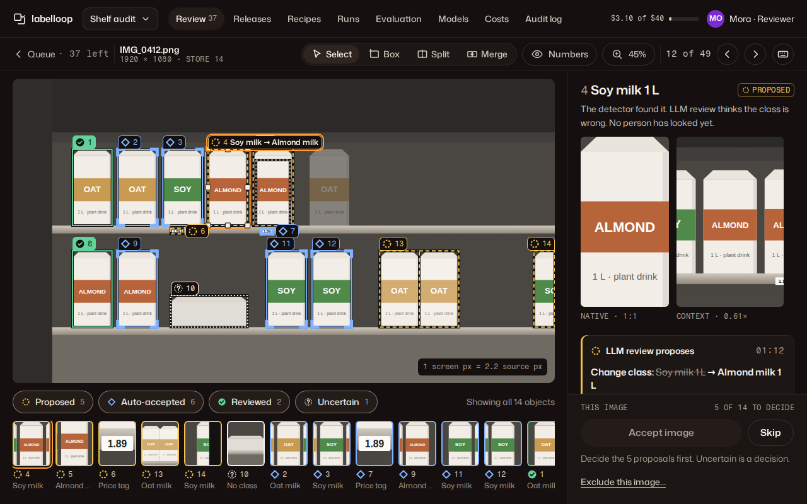
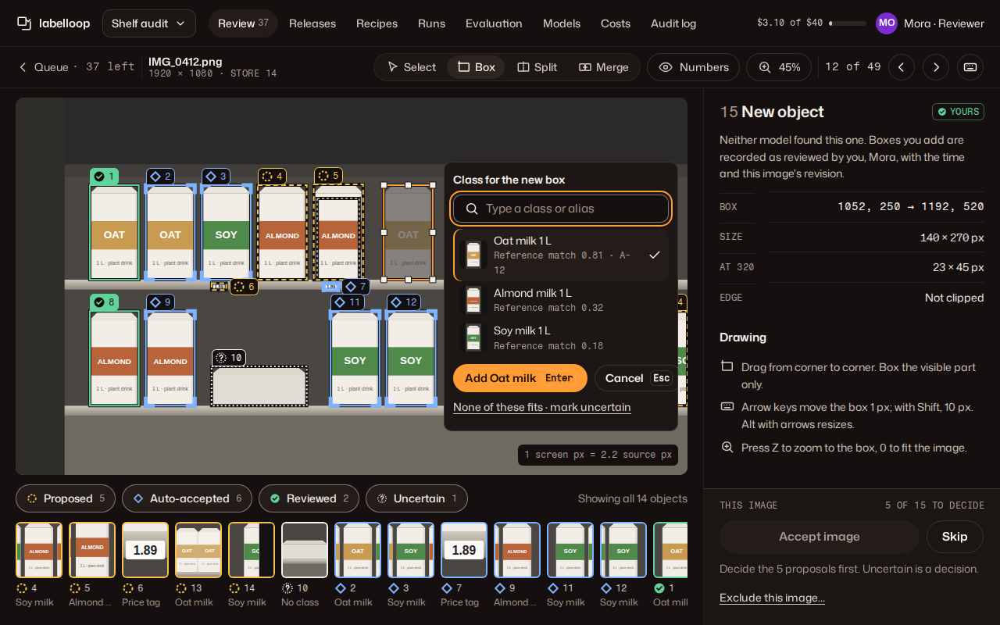
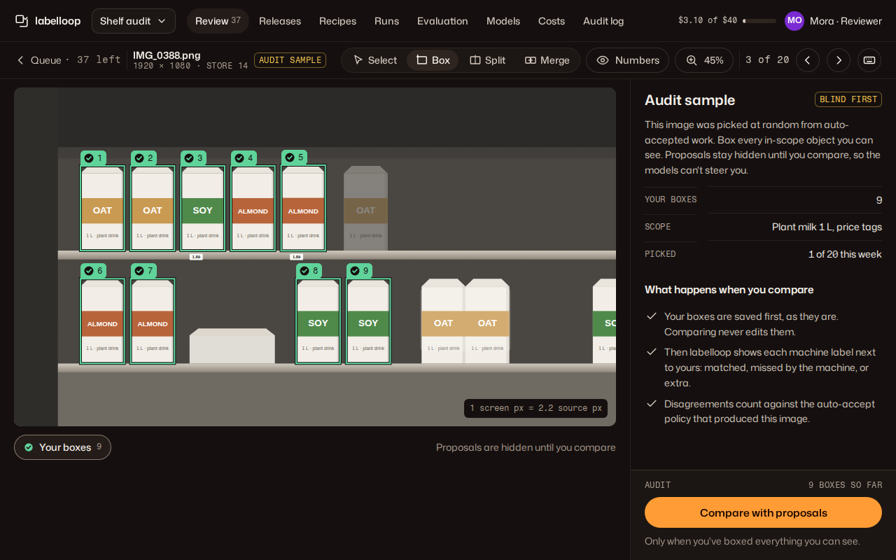
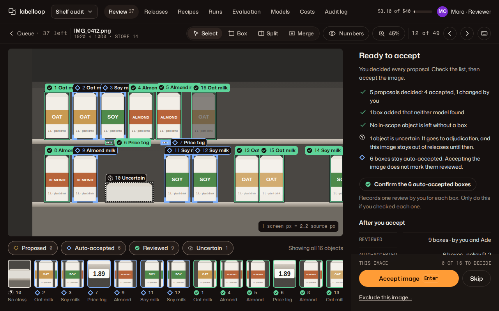

# 01 · Image review

**Plan:** §13.1 "Image review", §4.2 annotation state, §5.3–5.5 LLM evidence and correction, §10.2 audits, §16 checks 5, 10, 11, 16.
**Kit:** pattern P7; components J1–J12, A1, A4, A9, A10, A11, A14.
**Mockups:** `../mockups/png/review-*.png` (1280 viewport, 1280 tall, 390 full page).

| State | 1280 | 390 |
|---|---|---|
| R1 Deciding a proposal |  | [review-390-full.png](../mockups/png/review-390-full.png) |
| R2 Adding a box the models missed |  | [review-draw-390-full.png](../mockups/png/review-draw-390-full.png) |
| R3 Audit sample, blind first |  | [review-audit-390-full.png](../mockups/png/review-audit-390-full.png) |
| R4 Ready to accept |  | [review-ready-390-full.png](../mockups/png/review-ready-390-full.png) |

Full inspectors: `review-1280-tall.png`, `review-draw-1280-tall.png`, `review-audit-1280-tall.png`, `review-ready-1280-tall.png`.

## 1. Job and primary action

A reviewer decides, image by image, whether the labels are right and complete: they accept or keep each model proposal, fix what's wrong, add what was missed, and say when they can't tell. **Primary action: Accept image** (records the reviewer's completeness check and decisions, then opens the next image).

The screen exists to make one distinction impossible to miss: **proposed** (a model suggested it, nobody decided), **auto-accepted** (a qualified policy accepted it, no person looked) and **reviewed** (a named person decided). Everything else serves that.

Users: `reviewer` and `admin` roles (plan §12.2). Both can review. Only an admin can exclude an image permanently or edit the class catalog.

## 2. Provenance: what the screen shows for each state

The data model keeps separate fields (plan §4.2). The screen maps them to one visible tier per box, using the kit's provenance rule (components.md §J):

| Shown as | `approval_state` | `review_tier` | `label_state` | Box (J4) | Badge (J2) |
|---|---|---|---|---|---|
| Proposed | `draft`, `proposed` | `unreviewed` | any | dashed `label.proposed` | "Proposed" |
| Auto-accepted | `auto_accepted` | `machine_verified_no_human_review` | `identified` | solid `label.auto` + corner brackets | "Auto-accepted" |
| Reviewed | `human_accepted` | `human_reviewed` | `identified` | solid `label.reviewed`, filled tab | "Reviewed" |
| Adjudicated | `human_accepted` | `adjudicated` | `identified` | as reviewed | "Adjudicated" |
| Yours (this visit) | the reviewer's unsaved or just-saved decision | `human_reviewed` | any | as reviewed | "Yours" |
| Uncertain | any except `rejected` | any | `ambiguous`, `unknown`, `insufficient_evidence` | dotted `label.uncertain` + hatch | "Uncertain" |
| Rejected | `rejected` | any | any | hidden on the canvas; history only | "Rejected" |
| (not shown) | `superseded` | — | — | hidden; history only | — |

Rules:

1. `label_state` other than `identified` wins: an uncertain box shows as Uncertain whatever its approval state.
2. A box with an **open proposal** (class, geometry, split, merge, delete, duplicate) shows as Proposed, even if the box itself was auto-accepted or reviewed. The history (J9) says what it was before. Proposals against a reviewed or adjudicated box carry the extra line "A person reviewed this box. Changing it needs your decision" and are never auto-applied (plan §5.4).
3. **Accepting an image never upgrades auto-accepted boxes.** They stay auto-accepted unless the reviewer confirms them (one review event per box). The checklist in R4 says so in words.
4. The tier the viewer sees is computed by the API from those fields, not by the client. The client never sends `review_tier`; the API records it from the authenticated principal (plan §4.2, check 11).

## 3. Layout

### 1280 (P7)

| Region | Contents |
|---|---|
| J1 header | project switcher · sections (Review shows the queue count) · spend status · "Mora · Reviewer" |
| Tool row (sticky, 52 px) | "Queue · 37 left" link · file name + mono "1920 × 1080 · store 14" · audit tag when sampled · tool picker J11 (Select V, Box B, Split S, Merge M) · tab mode chip (Numbers / Names / Off, L) · zoom chip (Fit, 0 / 1 / Z) · mono "12 of 49" · previous / next image (Shift+N / N) · shortcuts (?) |
| Stage (fluid, scrolls) | image well J5 with box overlay J4 · legend and filter J5 · crop strip J6 |
| Inspector (380 px, scrolls) | the selected object, or the image when nothing is selected (§4) · decision dock J12 sticky at its bottom |

The stage and inspector scroll independently. The image well never scrolls out of view while the inspector does. At 1280 × 800 the well is 860 × 484 for a 16:9 image; taller images fit the stage height and scroll inside the well when zoomed.

### 390

Order: header (compact) · tool row (queue link, file name, position, previous / next) · **note** "Drawing, redrawing, split and merge need a screen 820 px or wider. Here you can decide proposals, change a class and mark uncertain." · image well (only the selected box keeps its tab) · legend (scrolls sideways) · crop strip · inspector · the decision dock as a fixed bottom bar (B4 behaviour; the mockup shows it at the end of the page because full-page captures can't show fixed bars).

**Audit samples are never served below 820 px.** At 390 the queue skips them (they stay in the queue for a wider screen). An audit sample opened by link shows the tool row, then only the info notice "Audit samples need a screen 820 px or wider. You need to box every object yourself before you compare, and drawing needs the larger screen." with the dock's Skip; no image, no proposals and no "Compare with proposals" (mockup R3 at 390).

At 390 a reviewer can: select objects (tap a tile or a box), accept or keep a proposal, change a class, mark uncertain, delete a box, confirm auto-accepted boxes, accept or skip the image. Drawing tools and handles are not rendered.

## 4. Inspector content

### 4.1 An object is selected (R1)

In this order:

1. **Head:** object number + class (`font-size.title`) · J2 badge. One plain sentence about who did what: "The detector found it. LLM review thinks the class is wrong. No person has looked yet."
2. **Crops (J6 larger):** Native (1:1 when it fits 340 × 270, otherwise the largest scale that fits; never above 4×) and Context (the box plus 50 % margin). Scale printed under each. These are source pixels, never the annotated overlay (plan §5.3).
3. **Proposed edit (J8)**, one card per open proposal, newest first. Detector proposals for brand-new objects read "The detector proposes"; LLM review proposals read "LLM review proposes".
4. **Reference views (J7):** the proposed class and the current class side by side (or the current class and its confusion pair when nothing is proposed). Only approved references; evaluation holdouts are never shown (plan §3.4).
5. **Class and box:** Class field (J10 on activate, C) · facts list: Box (source px), Size, size at each enabled recipe ("At 640 47 × 90 px", "At 320 23 × 45 px"; a recipe size at 6 px or less gets the warn tag "Tiny at 320"), Edge ("Not clipped" or "Clipped at the right edge") · buttons: Redraw (B), Split (S), Delete box (danger ghost, confirms in place).
6. **History (J9):** every event on this object, ending with the current truth ("No person has reviewed this object.").

### 4.2 Nothing selected

Image summary: counts per tier (same as the legend), completeness so far, "Select a box or press J to start with the first proposal." The crop strip is the fastest way in.

### 4.3 Ready (R4)

When nothing is left to decide, the inspector shows the image checklist:

- "5 proposals decided: 4 accepted, 1 changed by you"
- "1 box added that neither model found"
- "No in-scope object is left without a box" (the reviewer's assertion; the Accept action records it)
- uncertain line, if any: "1 object is uncertain. It goes to adjudication, and this image stays out of releases until then."
- auto-accepted line, if any: "6 boxes stay auto-accepted. Accepting the image does not mark them reviewed." + ghost "Confirm the 6 auto-accepted boxes" with the help line "Records one review by you for each box. Only do this if you checked each one."
- After you accept: facts list of the resulting tiers and "Completeness: checked by Mora".

## 5. Actions

Every action that changes data sends the image's expected revision (plan §4.4). Every action is undoable until the image is accepted: Ctrl/Cmd+Z, or the "Undo" link button on the decision's line in History (J9). The polite status region announces the decision and how to undo it.

| Action | How | Result | Shortcut |
|---|---|---|---|
| Accept a proposal | J8 "Accept change" | The proposed value becomes a new revision with `human_accepted` / `human_reviewed` by the reviewer. Box turns Reviewed. Next undecided object is selected. | A |
| Keep current | J8 "Keep {current}" | The proposal is `rejected` by the reviewer. The box keeps its value and becomes Reviewed (the reviewer looked at it). | R |
| Mark uncertain | J8 link, or the class picker footer | Asks for a reason in place: ambiguous / unknown object / not enough evidence + optional note. `label_state` changes; the object goes to the adjudication queue. | U |
| Change class | Class field or C → J10 | New revision with the chosen class, Reviewed. Any open class proposal on the box is closed as superseded. | C |
| Add a missing object | Box tool (B), drag on the image → J10 opens beside the box → "Add {class}" | New object, Reviewed, "Yours" until the image is accepted. | B, then Enter |
| Redraw a box | Drag handles, or Redraw (B with a box selected) and drag a new box, or type coordinates in the facts list | New geometry revision, Reviewed. The old box shows as a ghost until the reviewer moves on. | arrows: move 1 px (Shift 10) · Alt+arrows: resize |
| Split | Select a box, Split (S), draw the parts inside it (2 or more), pick a class for each (J10, defaults to the original class) | The original is superseded; the parts are new objects, Reviewed, linked to it in history. | S |
| Merge | Shift-click or Shift+J/K to select 2 or more boxes, Merge (M), confirm the class | The union box becomes one object, Reviewed; the originals are superseded. | M |
| Accept a proposed split or merge | J8 "Accept change" | As above, with the proposal's geometry. | A |
| Delete a box | "Delete box", confirm in place ("Delete box 4? *Delete* · Cancel") | `rejected` by the reviewer. Deleting a reviewed or adjudicated box needs a reason. | Delete |
| Confirm auto-accepted boxes | Per box: the J2 badge area shows "Confirm" on an auto-accepted box; for all: the R4 button | One review event per box; boxes turn Reviewed. | — |
| Accept image | Dock primary | Records the completeness assessment (scope hash, object-set revision, reviewer, time; plan §4.2) and the decisions; opens the next image. Available only when no proposal is undecided. | Enter (with no field focused) |
| Skip | Dock ghost | No change; the image goes to the end of the reviewer's queue. | N |
| Exclude this image | Dock link → confirm in place with a reason (out of scope / unusable / duplicate / legal) | Admin: excluded from releases with the reason. Reviewer: a request an admin approves. | — |

**Deliberately equal weight:** "Accept change" and "Keep {current}" are both ghost buttons. A primary Accept would steer people towards rubber-stamping the model.

**Bounded loops (plan §5.4):** a proposal that oscillates (the same box proposed and rejected twice) is not shown again. The history line reads "LLM review proposed this twice; it won't propose it again on this revision."

## 6. Keyboard

Single-key shortcuts work when no text field has focus, and can be turned off in account settings (WCAG 2.1.4). The shortcut sheet (?) lists them all.

| Key | Does |
|---|---|
| J / K | next / previous object in decision order |
| A · R · U | accept proposal · keep current · mark uncertain |
| C | change class (opens J10) |
| V · B · S · M | select · box · split · merge tools |
| Arrows · Shift+arrows · Alt+arrows | move 1 px · move 10 px · resize the selected box |
| L | cycle tab mode |
| 0 · 1 · Z | fit · 100 % · zoom to the selected box |
| Space + drag | pan |
| Enter | accept image (when ready) · commit the class picker |
| Esc | cancel the current tool or picker, then deselect |
| N · Shift+N | next · previous image |
| Ctrl/Cmd+Z · Shift+Ctrl/Cmd+Z | undo · redo |
| ? | shortcut sheet |

## 7. States

| State | What renders | Copy |
|---|---|---|
| Loading image | Well at its final aspect ratio on `bg.well`; legend, strip and inspector show their structure without numbers; no shimmer. Proposals load with the image, never after it (no pop-in of boxes). | — |
| Image failed to load | J5 failed state; dock primary unavailable. | "This image didn't load." · ghost "Try again" · "Skip to the next one" |
| Queue empty | P6 page instead of P7, C3 empty state. | "Nothing to review. 1,240 images are reviewed or auto-accepted." · ghost "Open the adjudication queue" |
| Nothing to decide on arrival | R4 straight away (all auto-accepted or reviewed). | "Nothing here needs a decision. Check the image is complete, then accept it." |
| Audit sample (R3) | Tool row shows the warn tag "Audit sample"; the overlay shows only the reviewer's own boxes; the legend is "Your boxes 9"; the inspector explains the rule; the dock primary is "Compare with proposals". After comparing, every machine box is paired with the reviewer's: matched, missed by the machine, extra; disagreements are recorded against the auto-accept policy (plan §10.2, §11.5). | "This image was picked at random from auto-accepted work. Box every in-scope object you can see. Proposals stay hidden until you compare, so the models can't steer you." |
| Audit sample below 820 px (R3 at 390) | The queue never serves an audit sample here. Opened by link: tool row with the "Audit sample" tag, an info notice, and the dock with Skip only. No canvas, no machine boxes, no Compare. | "Audit samples need a screen 820 px or wider. You need to box every object yourself before you compare, and drawing needs the larger screen." · ghost "Skip" |
| Stale proposal | J8 stale state: only Keep or Mark uncertain. | "This proposal was made on revision 4; the box has changed since." |
| Someone else changed the image | Warn notice at the top of the inspector, dock primary unavailable until resolved. The reviewer's decisions are kept as a draft. | "Ade changed this image at 01:20 while you were reviewing. Your 3 decisions are saved as a draft." · ghost "See Ade's changes" · ghost "Reapply mine" |
| Save failed | Danger notice in the inspector (`role="alert"`, it's the reviewer's own action); the decision stays on screen as unsaved. | "That decision didn't save. Try again. Nothing else changed." · ghost "Try again" |
| Truncated model output | The image shows the warn notice; Accept image stays available, but completeness can't be marked by the model (plan check 10). | "LLM review stopped part-way through this image. Check for missed objects yourself." |
| Proposals still running | Info notice; boxes shown are what has arrived; the dock primary waits. | "LLM review is still checking this image. You can start; new proposals appear in the strip." |
| Class has automation off | Proposals for that class show the neutral tag "Manual class". | — |
| Read-only (release frozen, or viewer without review rights) | No tools; inspector shows facts and history only. | "This image is in frozen release r0007. Changes go into the next release." |

## 8. Copy

Follow kit voice.md §7. Fixed strings:

- Proposal heads: "LLM review proposes", "The detector proposes".
- Model reason caption: "Model's reason · not checked by a person".
- Never "verified", "approved", "confirmed" for model output. "Auto-accepted under policy P-2" when the policy matters.
- The dock reason line: "Decide the {n} proposals first. Uncertain is a decision."
- Numbers: "12 of 49", "5 of 14 to decide", "1 screen px = 2.2 source px".

## 9. Accessibility

- Landmarks: header, `main` (holds the tool row, stage and inspector), the inspector as `aside aria-label="Selected object"`. One `h1` (visually hidden: "Review IMG_0412.png").
- The overlay is `aria-hidden`. The crop strip is the accessible list of objects: each tile is a button named "Object 4 Soy milk, Proposed"; J/K and Tab reach every object; selecting one moves focus to the inspector head.
- The image has alt text from its metadata ("Shelf photo, store 14 aisle 3"); it describes the source, not the labels.
- Drag has keyboard and typed alternatives (WCAG 2.5.7). Handles have 24 px hit areas.
- One polite status region announces decisions and their undo ("Object 4 is Almond milk 1 L now. Undo with Ctrl+Z."), filter results and tool changes. Never box counts ticking.
- Reduced motion: zoom and pan jump; nothing animates. Forced colours: strokes become `CanvasText`, selection `Highlight` (kit J4).
- Greyscale: tiers differ by stroke pattern, corner marks, tab fill and glyph (verified in the mockups).

## 10. Data the screen needs (API contract notes)

One request for the review view of an image returns: source image URL and dimensions; objects with computed tier, class, box, edge flags, per-recipe sizes; open proposals with kind, proposer (role, model, version, run), reason text, evidence ids, base revision; approved references per relevant class (ids, thumbnails, view tags); history per object; the image revision; queue position; audit-sample flag; enabled recipes. Writes: one endpoint per decision (plan §13.2 `POST /annotations/{id}/reviews` with the expected revision) and one for "accept image" carrying the completeness assessment. Every write returns the new image revision.

## 11. Acceptance checks for the build

1. In greyscale, a screenshot distinguishes proposed, auto-accepted, reviewed and uncertain boxes without tabs (pattern and corners only).
2. A model service principal can't produce a box shown as Reviewed or Adjudicated (plan check 11); the client has no way to send `review_tier`.
3. Accepting an image with auto-accepted boxes leaves them auto-accepted.
4. "Accept image" is unavailable while any proposal is undecided, and says why.
5. Every decision works by keyboard alone, including adding and redrawing a box.
6. An audit-sample image shows no machine boxes until "Compare with proposals". Below 820 px the queue skips audit samples, and one opened by link shows only the notice and Skip.
7. A concurrent edit by someone else blocks Accept and keeps the reviewer's decisions as a draft.
8. Model reason text renders as plain text (no HTML, no links).
9. axe: 0 violations at 1280 and 390; keyboard pass written in the PR (kit AGENTS.md §4).
