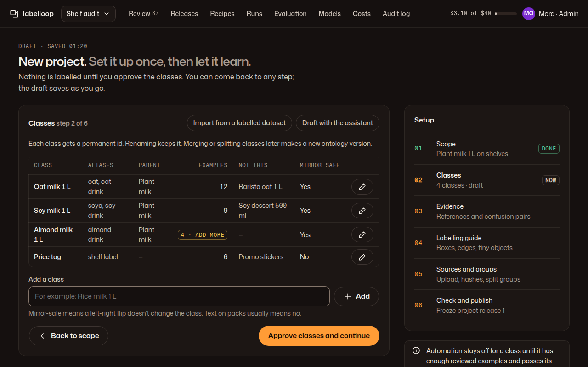

# 02 · New project

**Plan:** §3 (bootstrap), §3.2 class catalog, §3.3 geometry and completeness rules, §3.4 evidence, §3.5 source groups, §3.7 publish, §12.3 permitted use and LLM providers.
**Kit:** P6; J21 setup steps, J13 table, A11 fields, A14 notice, A1.
**Mockup:**  · [390](../mockups/png/new-project-390-full.png)

## Job and primary action

An admin turns a new visual domain into a draft project pack, then publishes project release 1. Nothing is bulk-labelled until the classes are approved. **Primary action per step:** "Approve {step} and continue"; on the last step "Publish project release 1".

## Layout

**1280:** page header (mono "Draft · saved 01:20", H1 "New project. *Set it up once, then let it learn.*", lede) · main card for the current step · rail: J21 steps card + a notice for what's blocking automation. **390:** header · steps card collapsed to one line ("Step 2 of 6 · Classes", button "All steps") · the step card · notice.

## Steps

| # | Step | Contents | Approve means |
|---|---|---|---|
| 1 | Scope | Name; what to detect (free text); representation layers (scene object, UI depiction, …, plan §3.1); intended use; specificity (category / product / character); permitted use of the source images; which LLM providers may see pixels (none = local only) | Scope frozen for the draft |
| 2 | Classes | J13 table: class, aliases, parent, examples count (warn tag "{n} · add more" under the minimum), "Not this" exclusions, mirror-safe yes/no. Import from a labelled dataset; "Draft with the assistant" proposes rows marked Proposed (J2) that the admin accepts one by one. Add-class field. | Ontology v1. Help: "Each class gets a permanent id. Renaming keeps it. Merging or splitting classes later makes a new ontology version." |
| 3 | Evidence | Upload or link references per class with source, permitted use, view, lighting, scale; pair confusable classes ("Often confused with"). Each reference shows J2 "Proposed" until an admin approves it. | Reference pack v1 (approved items only) |
| 4 | Labelling guide | Structured questions with examples, not a blank document: visible vs estimated extent (default visible), truncation at edges, occlusion, reflections, tiny objects (min px), exhaustive for scope (yes/no), what counts as out of scope background | Guide v1 |
| 5 | Sources and groups | Upload or connect images; computed dimensions, hashes, near-duplicate groups (plan §3.5) with the review band ("12 pairs need a look"), declared metadata keys (session, sequence, subject); split preview with group counts | Split assignment v1 |
| 6 | Check and publish | Summary of every frozen part with versions; recipes to start with (the two full-frame defaults); acceptance targets (null targets are allowed but block automatic promotion, shown as warn tags); budget limits (link to Costs) | Project release 1 |

Steps can be revisited; editing an approved step un-approves the steps that depend on it and says so ("Changing classes re-opens Evidence and Guide").

## States

- Draft autosaves; the mono line shows "saved 01:20" or "Saving…"; on failure: danger notice "Your last change didn't save. Try again." 
- Import errors list the rows in a J13 table with what to fix ("Row 14: class name is empty").
- Near-duplicate band pairs open a side-by-side compare (two J5 wells) with "Same group" / "Different groups".
- Reviewer role: sees the steps read-only, "Only an admin can change the setup."

## Copy

H1 "New project. *Set it up once, then let it learn.*" · lede "Nothing is labelled until you approve the classes. You can come back to any step; the draft saves as you go." · notice when a class is short of examples: "Automation stays off for a class until it has enough reviewed examples and passes its pilot. Almond milk needs at least 1 more."

## Acceptance checks

1. No bulk proposal job can start before step 2 is approved (plan §3.2).
2. Assistant-drafted classes and references show as Proposed until an admin accepts each.
3. The published release lists versions for ontology, guide, references, split assignment, recipes and policy (plan §3.7).
