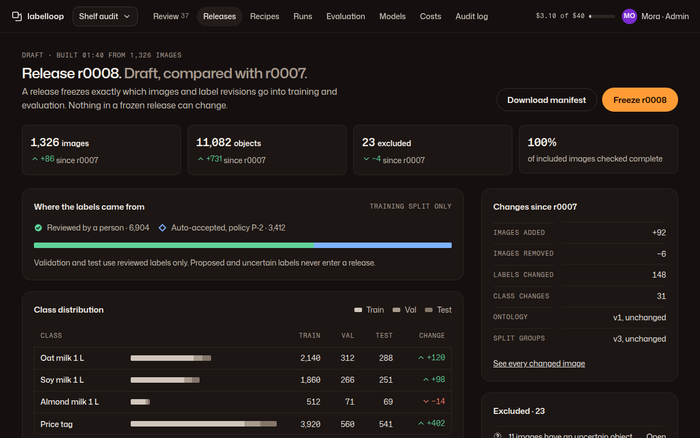

# 03 · Dataset releases

**Plan:** §4.1 canonical dataset release, §4.4 frozen releases, §5.5 training readiness, §3.5 quarantine, §6.4 compiler gate, §10.2 three collections.
**Kit:** P6; J13 table, J15 distribution bar, J16 delta, J9 history list, A14 notice, tiles (G5 pattern).
**Mockup:**  · [390](../mockups/png/releases-390-full.png)

## Job and primary action

An admin checks what a new release will contain against the last one, then freezes it. **Primary action:** "Freeze r0008" (freezing is permanent; it confirms in place: "Freeze r0008? Nothing in it can change after this. *Freeze* · Cancel").

## Layout

**1280:** page header (mono "Draft · built 01:40 from 1,326 images", H1 "Release r0008. *Draft, compared with r0007.*", actions: ghost "Download manifest", primary "Freeze r0008") · 4 tiles (images, objects, excluded, completeness), each with a J16 delta · main: "Where the labels came from" + "Class distribution" · rail: "Changes since r0007" + "Excluded". A release picker (chip "Compare with r0007 ▾") sits in the header meta line. **390:** tiles 2 × 2 · provenance · distribution table (scrolls inside) · changes · excluded.

## Sections

- **Where the labels came from** (training split): J15 bar with `label.reviewed` and `label.auto` segments and words ("Reviewed by a person · 6,904", "Auto-accepted, policy P-2 · 3,412"). Rule line: "Validation and test use reviewed labels only. Proposed and uncertain labels never enter a release." This keeps curated, auto-accepted and gold collections distinguishable (plan §10.2).
- **Class distribution:** J13 table, one row per class: J15 bar (train / val / test), counts per split, J16 change. A warn notice under the table when a class falls under the per-class support minimum: it will be "unsupported" in evaluation (plan §11.3).
- **Changes since:** facts list: images added / removed, labels changed, class changes, ontology version, split-group version; link "See every changed image" (a J13 table of images with a diff thumbnail and the change in words).
- **Excluded:** J9 list grouped by reason with counts and an "Open" link to the images: uncertain object waiting for adjudication · target under the recipe minimum · quarantined by a new near-duplicate relation · excluded by an admin (with their reason).

## States

| State | Renders |
|---|---|
| Draft building | Tiles show "Building…" (`aria-busy`), J19 "Running" with "812 of 1,326 images" |
| Gate failed | Danger notice above the tiles listing the failed compiler checks in words ("Val split is empty for 320: Platform would move 20 % of train into val."); Freeze unavailable with that reason |
| Frozen | H1 "Release r0008. *Frozen 7 Nov 02:10 by Ade.*"; no Freeze; manifest hashes shown in a facts list; "Compile recipes" link |
| Quarantine | When a new relation links train and a holdout, warn notice "5 images link r0007's test split to training. That test split is quarantined until it's reassessed." |
| Nothing changed | Info notice "r0008 would be identical to r0007." Freeze unavailable |

## Acceptance checks

1. Proposed and uncertain labels never appear in a release's counts.
2. Training-split provenance shows reviewed and auto-accepted counts separately.
3. A frozen release has no edit controls anywhere it is shown.
