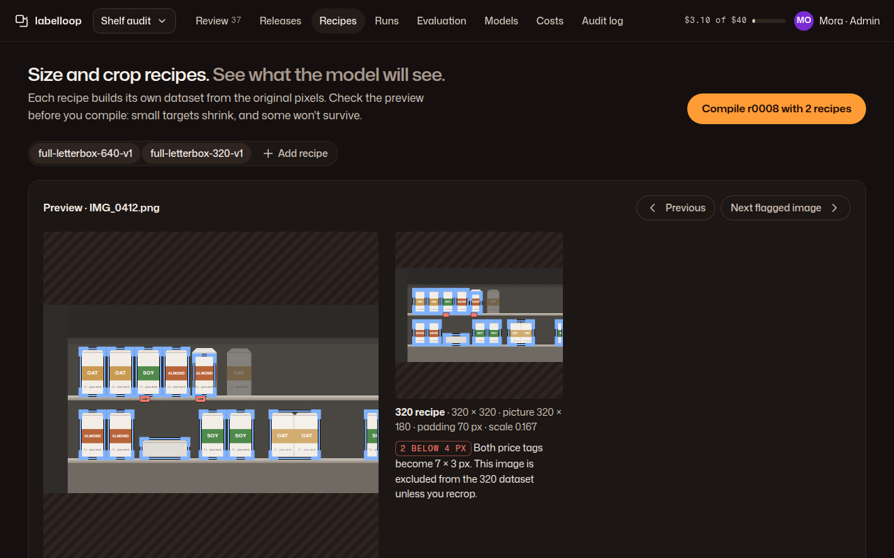

# 04 · Size and crop recipes

**Plan:** §7 (recipes, letterbox, crop, tiling), §9.4 dataloader filter and `min_target_px`, §6.4 compiler gate, §14 recipe config.
**Kit:** P6; J22 recipe preview frame, J4 box overlay, J13 table, A9 segmented, A14 notice.
**Mockup:**  · [390](../mockups/png/recipes-390-full.png)

## Job and primary action

An admin sees exactly what each recipe will feed the model, including which targets become too small or get clipped, before compiling. **Primary action:** "Compile r0008 with 2 recipes".

## Layout

**1280:** page header · recipe switcher (A9, multi-select pressed: the recipes compared side by side, plus "Add recipe") · preview card: image navigation (Previous · "Next flagged image") and one J22 frame per selected recipe at a shared display scale (0.75× in the mockup), each with its caption and flag tags · two columns: "Across r0008" flag table and the selected recipe's settings. **390:** frames stack at a shared scale that fits 350 px; table; settings.

## Rules for the preview

- Frames are drawn at one shared scale so the 320 frame looks half the size of the 640 one. Never stretch a 320 preview to fill the space.
- Boxes come from the recorded forward transform (the same code as the compiler), never re-derived in the browser.
- Flags: a target at or below `flag_target_px_at_or_below` (default 6 px) gets a warn tag; below `min_target_px` (default 4 px) gets a danger tag and the sentence of what the compiler will do (exclude or recrop). Clipped targets show the edge. Thick `label.rejected` boxes mark flagged targets.
- Padding is hatched and captioned with its real value ("grey 114 in the output").
- A recipe used by a frozen release is locked: "Edit" becomes "Make v2".

## States

- No release to preview: C3 "Compile needs a release. Freeze r0008 first." + link.
- A recipe that drops many images: danger notice with the consequence and a suggestion ("The 320 recipe would drop 212 images, mostly for price tags. Consider a tile recipe for price tags, or accept that 320 is qualified for cartons only.").
- Compiling: J19 per recipe; result links to the variant manifest and validation report; failures list the gate checks in words.

## Acceptance checks

1. The preview's derived sizes match the compiler's `transforms.jsonl` for the same image.
2. Every target under `min_target_px` is shown with what will happen to its image.
