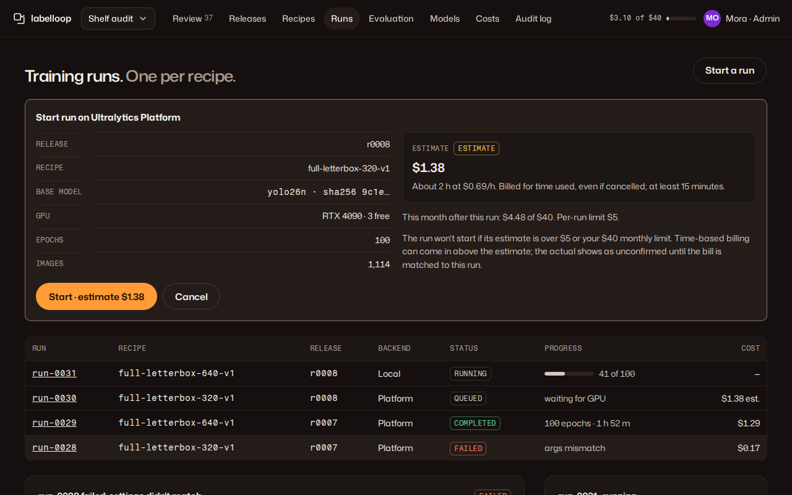

# 05 · Training runs

**Plan:** §9 (run contract, cloud flow, resolved-argument audit, dataloader audit, backends), §12 reconcile-before-retry, §12.1 budget gate.
**Kit:** P6; J13 table, J19 job status, J20 spend confirm panel, A15 progress, J18 (hashes), A14 notice.
**Mockup:**  · [390](../mockups/png/runs-390-full.png)

## Job and primary action

An admin starts a run for a release and recipe, follows it, and sees whether the run can be trusted. **Primary action:** "Start a run" (opens J20 in place; while open, the J20 button "Start · estimate $1.38" is the one ember surface and "Start a run" turns ghost). Local runs have no spend; their confirm reads "Start run on this server".

## Layout

**1280:** page header · (J20 when open) · runs table (J13): run, recipe, release, backend (Local / Platform), J19 status, progress, cost · two columns: the selected run's detail · rail: what's running now. **390:** confirm panel · table scrolls inside · detail · running card.

## The start panel (J20)

Fields: release, recipe (one run per recipe; two recipes = two runs), backend, base model with hash, GPU (Platform: always explicit, with availability), epochs, image count. Estimate tile with "Estimate" tag, price basis and billing rule. Month total after the run and the per-run limit. Ceiling line: "The run won't start if its estimate is over $5 per operation or your $40 monthly limit. Time-based billing can come in above the estimate; the actual shows as unconfirmed until the bill is matched to this run." The button names the estimate, never a cap (kit J20). Over any limit: no primary; danger notice names the limit with a link to Costs (plan §12.1). With "Spend without asking" on, the panel still shows and starts on one click inside limits.

## Run detail

- **Settings check:** after start, the resolved arguments are compared with the request; a mismatch fails the run (`args_mismatch`) and the card shows a J13 table "Asked for / Platform used" (plan §9.2).
- **Facts:** epoch, best validation metric and epoch, checkpoints saved (local: every epoch, hashed; Platform: `best.pt` only, hashed on download, "selected under provider rect validation"), targets kept by the dataloader ("12,410 of 12,418") with a link to the dropped ones (plan §9.4), updated time.
- **Actions:** Cancel run (danger ghost, confirms in place; Platform: "You're billed for the time used so far."), Copy settings to a new run, Open in Platform (external).

## States

| State | Renders |
|---|---|
| Accepted, waiting | J19 "Queued" · "waiting for GPU" |
| Running | J19 "Running" + progress bar + "41 of 100"; numbers update by text swap every 30 s; freshness line |
| Completed | ok tag; links to artefacts and "Evaluate" |
| Failed | danger tag + reason in words; never auto-retried |
| Cancelled | neutral tag + elapsed cost |
| Uncertain start (network error after POST) | warn notice "We're checking whether the platform started this run before trying again." (reconcile, plan §12) |
| Out of credits (402) | J19 "Paused" · "out of credits"; global banner from Costs |
| Platform busy (503) | warn "Ultralytics Platform is busy. Try again later; nothing was started." |

## Acceptance checks

1. No Platform run starts without a ledger estimate inside every limit (plan check 23).
2. A resolved-argument mismatch is shown key by key and fails the run.
3. Status updates never animate; changes are announced once.
