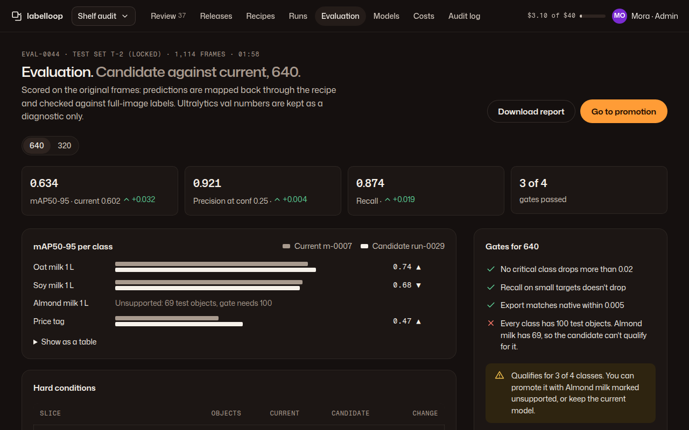

# 06 · Evaluation

**Plan:** §11 (evaluation roles, original-frame evaluator §11.6, per-class support §11.3, promotion rules §11.4, locked test §11.1), checks 14, 15, 17.
**Kit:** P6; tiles, J16 delta, J14 comparison bars, J13 table, A9 segmented (recipe), A14 notice.
**Mockup:**  · [390](../mockups/png/evaluation-390-full.png)

## Job and primary action

An admin compares a candidate with the current model for one recipe, on the original frames, per class and per hard condition, and sees which gates pass. **Primary action:** "Go to promotion" (links to Models with the candidate selected; promotion itself happens there).

## Layout

**1280:** page header (mono "eval-0044 · test set t-2 (locked) · 1,114 frames · 01:58"; H1 "Evaluation. *Candidate against current, 640.*"; lede says how it was scored) · recipe switcher (640 / 320, links) · 4 tiles: mAP50-95, precision at the release conf, recall, gates passed, each with its J16 delta · main: per-class J14 bars with "Show as a table" · hard conditions J13 table · rail: gates checklist + verdict notice. **390:** tiles 2 × 2, bars (label column 96 px), tables scroll inside, gates.

## Rules

- **Unsupported classes:** a class with fewer test objects than the gate minimum shows the reason in words in place of bars ("Unsupported: 69 test objects, gate needs 100") and never shows a filled-in metric (plan §11.3, check 15).
- **Slices:** size buckets in source px and in derived px, clipped, occluded, negatives (false detections on empty scenes), plus "Coverage lost to cropping or exclusion" (plan §11.6).
- **Locked test:** the header names the set and a mono line in the rail says how often it was opened ("Locked test set t-2 was opened once for this candidate"). Opening it a second time for the same lineage needs an admin confirm: "Opening t-2 again turns it into development data for later runs." (plan §11.1, check 17).
- **Ultralytics val** numbers sit behind "Show provider diagnostics", labelled "diagnostic only".
- Charts are never the only carrier: bars are `aria-hidden` with a hidden sentence list and the table toggle.

## Verdicts (rail notice)

| Result | Notice |
|---|---|
| All gates pass | ok "Qualifies for 640. Promote it from Models." |
| Some classes unsupported | warn "Qualifies for 3 of 4 classes. You can promote it with Almond milk marked unsupported, or keep the current model." |
| A gate fails | danger "Doesn't qualify: recall on small targets drops 0.06." |
| Running | J19 "Running" · "412 of 1,114 frames" |
| No current model | Tiles show candidate values only; deltas read "first model" |

## Acceptance checks

1. Every metric shown names its set and size; no metric shows for an unsupported class.
2. 320 and 640 are evaluated and shown separately; a 640 pass says nothing about 320.
