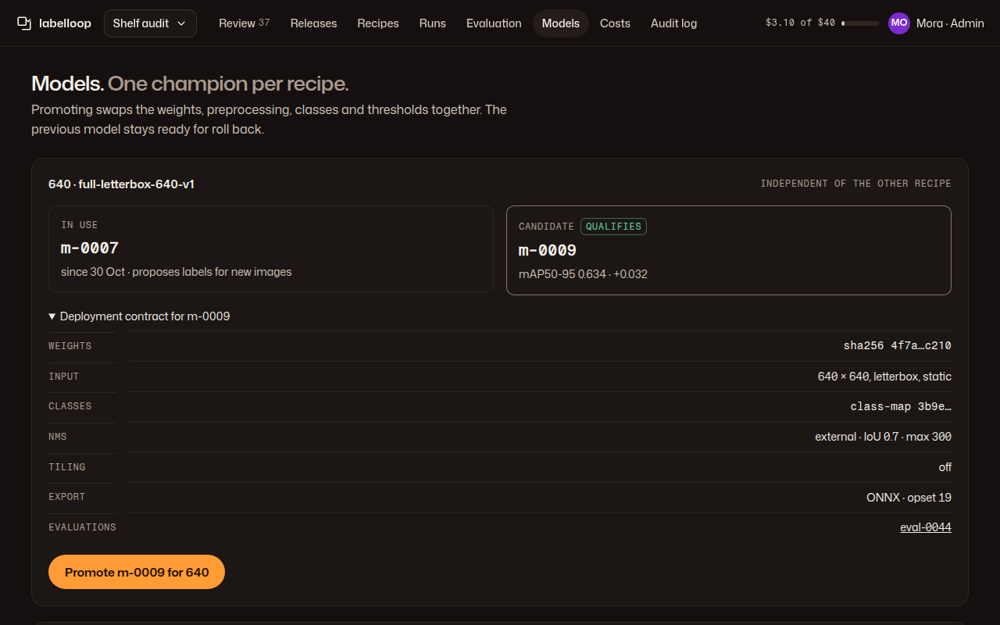

# 07 · Model registry

**Plan:** §9.8 model release record, §11.4 promotion and rollback, §11.5 drift pause, check 19.
**Kit:** P6; tiles, J13 table, J19, C6 facts list, A1.
**Mockup:**  · [390](../mockups/png/models-390-full.png)

## Job and primary action

An admin promotes a qualifying candidate for one recipe, or rolls a recipe back, knowing exactly which weights, preprocessing, classes and thresholds go live together. **Primary action:** "Promote m-0009 for 640" (only when a candidate qualifies; at most one ember per page, so with two qualifying recipes the second promote is ghost).

## Layout

One card per recipe, then history. **Recipe card:** title "640 · full-letterbox-640-v1" + mono "Independent of the other recipe" · two tiles: "In use" (model id, since when, what it does: "proposes labels for new images") and "Candidate" (id, headline delta, ok "Qualifies" or danger "Not qualified") · deployment contract (details, open for the recipe with a promotable candidate): weights hash, input size and mode, class-map hash, NMS mode / IoU / max detections, tiling, export format, evaluation ids (plan §9.8) · action row. **History:** J13 table (UTC time, recipe, change, by, row action "Roll back 640 to m-0005").

## Actions

- **Promote:** confirms in place with the contract summary: "Promote m-0009 for 640? It replaces m-0007 for new proposals. m-0007 stays ready for roll back. *Promote* · Cancel". Records a promotion event with the gate results (plan §4.1).
- **Not qualified:** ghost "Promote" with `aria-disabled` and the reason ("Fails the small-target recall gate. See evaluation").
- **Roll back:** row action, confirm in place, needs a reason (free text, e.g. "drift on store 9").
- **Canary (M5):** a qualifying candidate can first run as canary on fresh source groups: neutral tag "Canary · 3 of 10 groups"; promote stays available.
- **Drift pause:** when audits pause automatic acceptance for a class or source, the card shows warn "Auto-accept is paused for Price tag: audit errors rose to 4 %." with link to the audit sample.

## States

No models yet (C3 "No model for 640 yet. Train one from Runs."), candidate evaluating (J19), promotion failed (danger notice, the current model stays in use: "Promotion didn't finish. m-0007 is still in use.").

## Acceptance checks

1. Promoting one recipe never changes the other (check 19).
2. The contract shown before promotion is the exact record that goes live.
