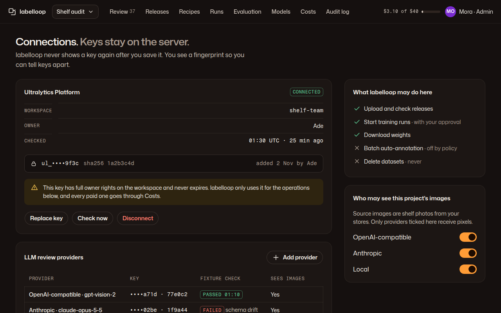

# 08 · Connections

**Plan:** §8.1 connection and resource ownership, §12.2 secrets, §12.3 which providers see pixels, §5.3 fixture probes.
**Kit:** P6; J18 secret fingerprint, J13 table, A12 toggle, A11 field, A14 notice.
**Mockup:**  · [390](../mockups/png/connections-390-full.png)
**Where:** from the account menu (J1 avatar) → "Connections". Admin only; reviewers see "Only an admin can manage connections."

## Job and primary action

An admin connects the Ultralytics Platform workspace and LLM providers, sees what labelloop may do with each, and controls which providers see this project's images. Keys are entered once and never shown again. **Primary action:** none when connected (no ember on this page); when not connected, "Connect workspace".

## Layout

**1280:** page header (H1 "Connections. *Keys stay on the server.*") · main: Ultralytics Platform card, LLM providers card · rail: "What labelloop may do here" checklist, "Who may see this project's images" toggles. **390:** cards stack in that order.

## Ultralytics Platform card

- Status tag: ok "Connected", warn "Check failed" (with reason), neutral "Not connected".
- Facts: workspace slug (exact id, never a display name), owner, last check (UTC + relative).
- J18 fingerprint: "ul_••••9f3c · sha256 1a2b3c4d · added 2 Nov by Ade". No reveal, no copy.
- Warn notice, always: "This key has full owner rights on the workspace and never expires. labelloop only uses it for the operations below, and every paid one goes through Costs."
- Actions: Replace key (write-only field + "Check and save"; validates with a read of the workspace and records the change in the audit log, plan §12.2) · Check now · Disconnect (danger, confirm in place).
- Connect form (not connected): "Paste a Platform API key", help "Create a named key in Ultralytics Platform → Settings → API keys. It starts with ul_.", then a workspace picker from the key's response.

## LLM providers card

J13 table: provider and model · key fingerprint (or "No key" for local) · fixture check (ok "Passed 01:10" / danger "Failed" + reason) · sees images (yes / on this server). "Add provider": base URL, model, key (write-only), then the fixture probe runs before first use (plan §5.3). A failed probe keeps the provider out of use: "A provider that fails its fixture check isn't used until it passes again."

## Rail

- **What labelloop may do here:** check / cross list of operations (upload and check releases; start training runs "with your approval"; download weights; batch auto-annotation "off by policy"; delete datasets "never").
- **Who may see this project's images:** one A12 switch per provider, with the project's permitted-use line above. Turning one off takes effect for new requests; the status says so.

## Copy and security rules

- Never print a key, a partial key beyond prefix + last 4, a bearer header or a signed URL. Errors from providers are summarised in our words, not echoed.
- Key field: `autocomplete="off"`, `spellcheck="false"`, type password, cleared on save and on navigation.

## Acceptance checks

1. No API response or rendered page contains a secret (plan check 24); the page shows fingerprints only.
2. Replacing a key writes an audit event with the old and new fingerprints.
