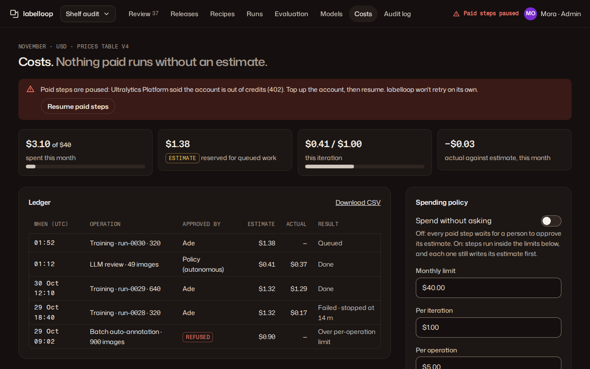

# 09 · Costs

**Plan:** §12.1 spend control, §8.6 and §9.2 billed operations, check 23.
**Kit:** P6; tiles, J17 budget meter, J13 table, A12 toggle, A11 fields, A14 notice.
**Mockup:**  · [390](../mockups/png/costs-390-full.png)

## Job and primary action

An admin sees what was spent and reserved against the budgets, sets the limits, and decides whether labelloop may spend without asking. **Primary action:** "Save limits". Reviewers see the page read-only (no fields, no toggle).

## Layout

**1280:** page header (mono "November · USD · prices table v4", H1 "Costs. *Nothing paid runs without an estimate.*") · paused banner when it applies · 4 tiles: spent this month (J17), reserved for queued work ("Estimate" tag), this iteration (J17), actual against estimate · main: ledger · rail: spending policy. **390:** banner, tiles 2 × 2, policy card **before** the ledger (it holds the decision), ledger scrolls inside.

## Ledger

J13 table, newest first: UTC time, operation (kind · object · recipe), approved by (a person's name, "Policy (autonomous)", or danger tag "Refused"), estimate, actual, result in words ("Failed · stopped at 14 m", "Over per-operation limit"). Every paid operation appears, including refused ones (plan §12.1). Filters: chips by kind (Training, LLM review, Auto-annotation, Predict). "Download CSV".

## Spending policy

- A12 "Spend without asking", default off. Consequence line: "Off: every paid step waits for a person to approve its estimate. On: steps run inside the limits below, and each one still writes its estimate first."
- Limits: monthly, per iteration, per operation (required before any paid operation; empty = paid steps unavailable with "Set a monthly limit first"). Help: "An operation over any limit is refused, never queued."
- Turning the switch on confirms in place and names the limits: "labelloop starts paid steps without asking while each estimate is $5 or less and this month's spend, plus estimates reserved for queued work, plus the new estimate stays within $40. Actual billing can come in above an estimate. *Turn on* · Cancel". The limits are checked against estimates, so the copy never calls them a cap on what is billed (plan §12.1).

## States

| State | Renders |
|---|---|
| Paused by a 402 | Danger banner (also shown in J1 as "Paid steps paused" on every page): "Paid steps are paused: Ultralytics Platform said the account is out of credits (402). Top up the account, then resume. labelloop won't retry on its own." · ghost "Resume paid steps" |
| Over 80 % of a limit | J17 warn; notice "You've used 84 % of November's limit." |
| At a limit | J17 danger; start buttons elsewhere show the reason |
| No spend yet | Tiles show $0.00; ledger C3 "Nothing paid has run yet. Local training and review are free." |

## Acceptance checks

1. Every row has an estimate; actuals appear only after completion; estimates carry the "Estimate" tag.
2. A 402 pauses paid steps everywhere and is never retried automatically (check 23).
