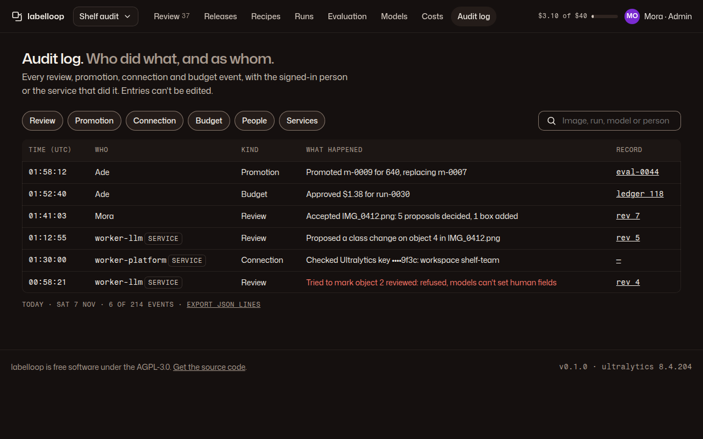

# 10 · Audit log

**Plan:** §12.2 principals and audit trail, §4.2 review events, §11.4 promotion events, check 11.
**Kit:** P6; J13 table, A10 chips, A11 search, A4 tags.
**Mockup:**  · [390](../mockups/png/audit-390-full.png)

## Job and primary action

An admin answers "who did what, and as whom": review decisions, promotions, connection changes and budget events by person or service principal. Read-only; entries can't be edited. **Primary action:** none (no ember); "Export JSON lines" is a link.

## Layout

**1280:** page header (H1 "Audit log. *Who did what, and as whom.*") · filter row: kind chips (Review, Promotion, Connection, Budget), who chips (People, Services), search ("Image, run, model or person"), date range · J13 table · footer mono "Today · Sat 7 Nov · 6 of 214 events" + export. **390:** chips scroll sideways; the table keeps Time, Who, What; Kind and Record fold into the What cell's second line.

## Table

Columns: Time (UTC, mono, to the second) · Who (a person's name, or a service principal in mono + neutral tag "Service") · Kind · What happened (one sentence in voice.md §7 grammar) · Record (link to the image revision, run, ledger row or evaluation).

Sentence patterns: "Accepted IMG_0412.png: 5 proposals decided, 1 box added" · "Promoted m-0009 for 640, replacing m-0007" · "Approved $1.38 for run-0030" · "Checked Ultralytics key ••••9f3c: workspace shelf-team" · "Replaced the Ultralytics key: ••••71aa → ••••9f3c". Refused actions are logged in `state.danger` text, e.g. a model worker trying to set a human field: "Tried to mark object 2 reviewed: refused, models can't set human fields" (plan check 11).

## States

Empty filter: C3 "No budget events this week." + "Clear filters". Loading more: "Show 50 more" button at the end (no infinite scroll). Reviewer role: sees only review events, their own and others', with the note "Admins see every kind."

## Acceptance checks

1. Every review, promotion, connection and budget event appears with its authenticated principal.
2. No secret or full key appears in any entry (fingerprints only).
