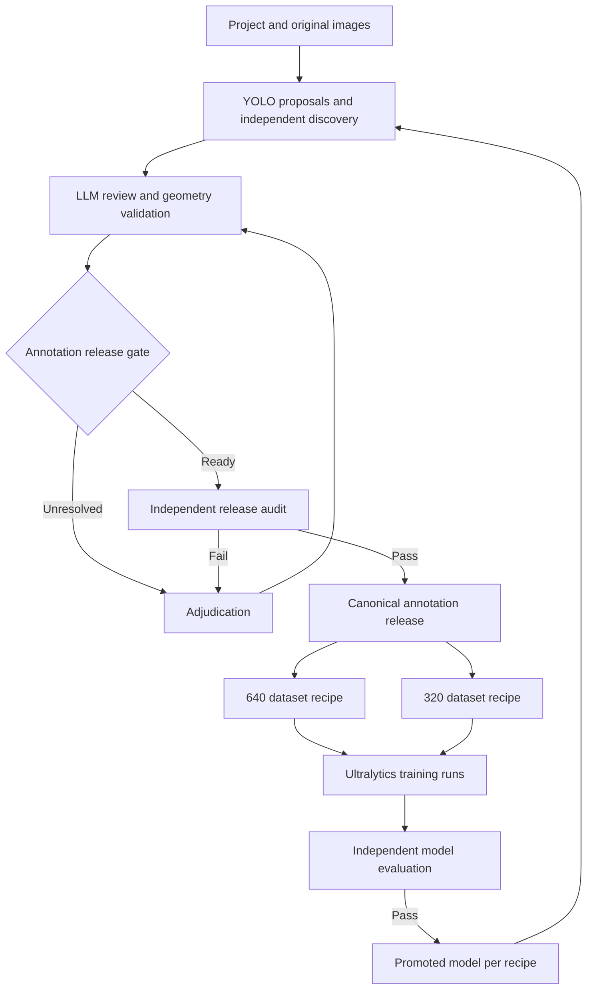

# Multi-domain image annotation and YOLO training application

**Design version:** 0.3 (final for build start)  
**Research checked:** November 6, 2026 (v0.2); re-verified November 7, 2026 (v0.3)  
**Deliverable:** implementation plan and proposed contracts  
**Initial task:** axis-aligned object detection on still images  
**Repository:** https://github.com/TogetherWeOwn/labelloop (AGPL-3.0)

> **v0.3 changes in brief.** v0.3 adds budget and cost controls (§12.1), secrets and auth (§12.2), licensing (§12.3), a concrete stack and local/CI runtime (§2.3), a CI-safe local training backend (§9.7), an original-frame evaluator (§11.6), a near-duplicate method (§3.5), and milestones reordered around an offline-first vertical slice with acceptance checks mapped to them (§15–16). Vendor facts were re-verified, and the corrections are marked **[v0.3]** inline. The review findings behind each change are in `docs/plan-review.md`.

**Navigation:** [Architecture](#2-architecture) · [Project bootstrap](#3-bootstrap-every-new-project) · [Canonical data](#4-canonical-data-and-lineage) · [LLM review](#5-automatic-labeling-and-llm-review) · [YOLO compiler](#6-deterministic-yolo-dataset-compiler) · [320/640 recipes](#7-separate-image-size-and-field-of-view-variants) · [Ultralytics account integration](#8-integration-with-the-users-ultralytics-platform-account) · [Training](#9-training-a-model-for-each-recipe) · [Improvement loop](#10-progressive-improvement-controller) · [Evaluation](#11-evaluation-qualification-and-rollback) · [Configuration](#14-example-project-and-recipe-configuration) · [Acceptance checks](#16-required-acceptance-checks)

## 1. Goal and operating principles

Build an application that can bootstrap a new visual domain, produce reviewable annotations, compile reproducible YOLO datasets, train separate models through the user's Ultralytics Platform account, and improve both labels and models through repeated measured iterations.

Each project owns a versioned class catalog, annotation guide, reference bank, original images, annotation history, evaluation sets, preprocessing recipes, dataset releases, and model lineage. The engine must support unrelated projects without changing its core code. Game characters, product SKUs, wildlife species, industrial components, and interface elements are example domains.

The desired automation is:

1. Propose labels using an initial detector and approved visual references.
2. Review object identity, geometry, and missing objects with vision-capable language models and deterministic checks.
3. Resolve uncertain cases and audit a sample independently.
4. Freeze an accepted annotation release.
5. Build separate YOLO datasets for selected image recipes, including 640 x 640 and 320 x 320.
6. Train and evaluate a candidate model for each recipe.
7. Promote qualifying candidates and use them to propose labels for new images.
8. Repeat when new evidence or measured failures justify another iteration.

The application's release claim is **qualified for a declared scope and measured quality target**. A finite test cannot establish that a model will be perfect on every future image. An LLM can also miss objects or agree with an incorrect detector. Keep independent evaluation, explicit uncertainty, and ongoing audits as part of the product. A zero-error result on a named finite test set can be reported precisely, with the set version and sample size; it must not become an unconditional promise.

Code owns file processing, geometry, data validation, revisions, split assignment, dataset compilation, rendering, orchestration, and release gates. Models supply visual predictions and proposed corrections. Image content and model text never directly execute application actions.

Vendor capabilities cited below are researched facts. The architecture, recipes, database entities, workflow states, and implementation milestones are proposed design choices. This document does not claim that an account was connected, a training job was launched, or a model was evaluated during preparation.

## 2. Architecture

Keep canonical evidence and annotation history in the application. Use Ultralytics Platform for account-backed dataset workspaces, review tools, training runs, model artifacts, and experiment tracking. Preserve an adapter boundary so application records remain complete if a platform field or API changes.



### 2.1 Components

| Component | Responsibility |
|---|---|
| Project service | Ontology, annotation guide, domain references, release configuration |
| Asset service | Immutable source pixels, hashes, orientation, lineage, source groups |
| Proposal workers | Initial detectors, project YOLO models, optional segmentation refinement |
| Evidence service | Approved visual-reference retrieval and confusing alternatives |
| LLM review adapter | Bounded image review with schema-validated proposals |
| Annotation service | Revisions, review events, completeness, human/model provenance |
| Dataset compiler | Source-to-variant transforms, YOLO labels, manifests, validation |
| Platform adapter | Authentication, dataset synchronization, training, status, checkpoints |
| Evaluation service | Grouped holdouts, full-frame detection metrics, release decisions |
| Model registry | Checkpoint lineage, per-recipe champion/challenger, rollback |
| Review interface | Full image, crops, references, additions, corrections, uncertainty |
| Deterministic renderer | Boxes, legends, class colors, comparison previews |

Use a Python API and workers for vision integration, a TypeScript interface for project management, PostgreSQL for canonical records, and object storage for images and model artifacts. A durable database-backed job queue is sufficient for an initial deployment. Add a separate queue service only when operational measurements justify it. Section 2.3 pins the concrete choices.

Ultralytics Platform already provides annotation and custom-model prediction interfaces. Reuse these where they support the workflow, while adding a focused application review screen for reference evidence, cross-resolution comparisons, and annotation lineage. Its editor and batch tools do not replace the application's quality policy. [U3]

### 2.2 Boundaries of determinism

Deterministically reproduce all transforms, exports, colors, legends, class mappings, and release membership from a pinned manifest. Record image-decoder, interpolation, encoder, font, application, and dependency versions where they affect output.

Neural training and hosted inference have statistical and implementation-dependent behavior. Setting a random seed or temperature does not establish universal bitwise reproducibility. Preserve checkpoints, configurations, and actual outputs; use repeated model experiments when variation is material to a release decision. [O3]

### 2.3 Concrete stack and runtime [v0.3]

| Layer | Choice | Notes |
|---|---|---|
| Python | 3.12, `uv` workspace, `ruff`, `mypy --strict` on core packages, `pytest` | One lockfile (`uv.lock`) |
| API | FastAPI + Pydantic v2, SQLAlchemy 2 + Alembic | OpenAPI is generated and checked in, and the web client is generated from it |
| Queue | Postgres-backed jobs (`FOR UPDATE SKIP LOCKED`) with leases, heartbeats and bounded retries | No Redis in v1 |
| Database | PostgreSQL 16 + `pgvector` | The reference embedding index lives in Postgres |
| Object storage | S3-compatible API; MinIO locally | Content-addressed keys (`sha256/<aa>/<hash>`) |
| Imaging | Pillow + OpenCV-headless, versions pinned | The decoder and encoder versions are recorded in every manifest |
| ML worker | separate `worker-ml` package that imports `ultralytics`/PyTorch | The only package that imports `ultralytics` (§12.3) |
| Web | TypeScript, React + Vite, `pnpm` | Built from `TogetherWeOwn/two-design-kit` tokens and components; screen designs are produced before implementation |
| LLM access | OpenAI-compatible `/v1/chat/completions` plus Anthropic Messages adapters behind `LLMReviewer` | Each configured model is probed with a fixture before use (§5.3) |
| Workers | `worker-core` (non-ML stages), `worker-ml` (ultralytics), `worker-llm` (LLM review calls), `worker-platform` (Platform mutations) | Separate processes and containers. Only `worker-llm` and `worker-platform` hold a decryption key, each for its own secret type (§12.2) |
| Local runtime | `docker compose`: postgres, minio, api, worker-core, worker-ml (CPU), worker-llm, worker-platform, web | `make dev`, `make test` |
| CI | GitHub Actions only: lint, type-check, unit, geometry property tests, compiler determinism, CPU tiny-training smoke on the local backend | No paid account in CI; the live Platform smoke is opt-in (§9.7) |

Repository layout (monorepo):

```text
apps/api/            FastAPI service (project, asset, annotation, release, model registry)
apps/web/            React review and management UI
packages/core/       domain model, geometry, transforms, split grouping, state machines (pure Python, no I/O)
packages/compiler/   deterministic YOLO dataset compiler + validators
packages/platform/   Ultralytics Platform adapter (generated client + contract tests)
packages/llm/        LLM reviewer adapters, schemas, probes
workers/core/        job runner for non-ML stages
workers/ml/          proposals, controlled training/eval/export (imports ultralytics)
workers/llm/         LLM review job runner (uses packages/llm; holds the LLM key-decryption key)
workers/platform/    Platform mutation job runner (uses packages/platform; holds the Platform key-decryption key)
fixtures/            tiny licence-clean datasets and golden outputs
docs/                plan, ADRs, runbooks
```

## 3. Bootstrap every new project

The setup flow should produce a concrete draft project pack, followed by a measured pilot and a published project release.

### 3.1 Define scope and identity granularity

Capture the target objects, image sources, intended downstream use, and required specificity. A project may detect a general category, a species, a particular product SKU, or a fictional character. Record composite objects, subparts, variants, and attributes explicitly.

Separate depictions from physical scene objects when needed. For example, the Deadlock demonstration has world characters and HUD portraits. They can share a semantic class but belong to different representation layers and can require separate dataset/model families.

### 3.2 Create the class catalog

Support a user-supplied list, import from an existing labeled dataset, and an assistant-drafted catalog. The owner approves definitions before bulk annotation. Store permanent project-scoped class IDs, display names, aliases, optional parents, positive examples, and exclusions.

YOLO integer indices are release-specific export mappings. A display-name change preserves identity. Class merges, splits, and changes in target scope create a migration and a new ontology version. Every resolution variant derived from one release uses the same class mapping unless an explicit subset recipe says otherwise.

### 3.3 Establish geometry and completeness rules

Define visible versus estimated hidden extent, carried equipment, visual effects, overlapping instances, reflections, UI depictions, truncation at image edges, and tiny objects. Start with visible extents and leave estimated hidden extent unset.

Specify whether labels are exhaustive for the selected scope. An unfinished image or a low-confidence prediction with zero boxes is not a verified negative image. Out-of-scope objects can be background by explicit policy; an unresolved in-scope target must not silently become background.

### 3.4 Enroll evidence

Accept approved images, catalogs, documents, source URLs, and existing labels. Store source, permitted use, class identity, view, lighting, scale, variant, domain version, reviewer, and validity scope. Build representative examples and confusion pairs.

Reference retrieval must respect project permissions and exclude evaluation holdouts. Cross-project reuse is an explicit import of a named, versioned pack with class mapping and provenance.

### 3.5 Sample and group the source collection

Compute dimensions, hashes, suspected near duplicates, object-scale indicators, and visual clusters. Sample across easy and difficult conditions. Record source recording, capture session, scene, subject/product identity where relevant, and near-duplicate group.

Assign split groups before generating crops, tiles, resizes, or augmentations. All derivatives of a source image inherit its split. Related frames and near duplicates must not appear on both sides of an evaluation boundary.

Treat these relationships as conservative grouping constraints with transitive closure, not a concatenated tuple of metadata fields. Near duplicates across two sessions still belong together. Choose physical-instance or subject grouping according to the evaluation question; do not group an entire semantic class into one split when evaluating closed-set class recognition. If new relationships connect training and holdout groups, quarantine the affected evaluation release and either obtain a fresh independent holdout or retrain without the connected groups.

**[v0.3] Near-duplicate and grouping method.** Relations come from:

- exact SHA-256 equality;
- a 64-bit perceptual hash (pHash) with Hamming distance ≤ `phash_max_distance` (default 8);
- image-embedding cosine similarity ≥ `embed_min_cosine` (default 0.95, recorded with the embedding model version);
- declared metadata keys (session, sequence, subject).

A union-find over all relations yields the split groups. Pairs inside a configurable band below each threshold go to a review queue instead of being silently merged or separated. Thresholds, the embedding model and the algorithm version are part of the split-assignment version. Groups are assigned to splits with a seeded deterministic stratified assignment over group-level class counts.

### 3.6 Establish seed labels and independent evaluation

Prefer existing reliable labels or a carefully reviewed seed. Generic detection, class-prompted models, reference retrieval, and LLM review can bootstrap draft labels. Generic detection alone cannot assign a fine-grained identity it has not established.

Independently verify seed evaluation labels. Where the image-producing system supplies trustworthy machine-readable ground truth, an adapter can ingest it with alignment checks and source provenance. Otherwise include domain review. Model agreement does not automatically establish ground truth.

No universal number of examples per class guarantees accuracy. Expand the seed according to class coverage, learning curves, and observed failures. Keep automation off for unsupported classes or conditions.

### 3.7 Publish the project configuration

Freeze ontology, guide, approved references, source-group assignments, recipe definitions, model/provider configurations, review policy, and acceptance targets. Create a project-release ID. Bulk jobs pin it; later changes create a new version.

## 4. Canonical data and lineage

The canonical source labels belong to original, orientation-normalized images. Sized YOLO datasets are reproducible derivatives. Editing labels independently in every size variant would create contradictory truths; correct the canonical source revision and rebuild affected variants.

### 4.1 Core entities

| Entity | Required information |
|---|---|
| Project | Owner/workspace, task, scope, domain, access policy |
| Ontology release | Stable class IDs, definitions, aliases, hierarchy, class-index mapping |
| Source asset | SHA-256, original bytes, dimensions, orientation, source URI, source group |
| Reference example | Asset/crop, class ID, evidence provenance, approval, validity scope |
| Proposal run | Teacher checkpoint, detector/provider version, parameters, prompt, evidence IDs |
| Annotation revision | Object ID, class or uncertainty state, visible geometry, attributes, parent revision |
| Review event | Reviewer type/identity, decision, correction, reason, expected revision, time |
| Source split assignment | Group ID, split, assignment version, reason, lock status |
| Canonical dataset release | Exact source and annotation revisions, completeness, exclusions, hashes |
| Preprocessing recipe | Crop/tiling policy, output size, resize/padding rules, encoder, version |
| Derived sample | Source ID, crop rectangle, actual scale/padding, forward/inverse transform, hash |
| YOLO dataset variant | Canonical release, recipe, class mapping, file manifest, Platform mapping |
| Training run | Dataset variant, checkpoint parent, recipe, resolved arguments, environment, status |
| Model artifact | Weights hash, expected preprocessing, classes, model family, export shape |
| Evaluation run | Model, frozen dataset, protocol, per-class support, slice metrics, findings |
| Promotion event | Prior model, candidate, gate results, decision, rollback pointer |

Use object storage for original pixels, crops, release archives, logs, and checkpoints. PostgreSQL remains authoritative for ownership, versions, status, and relationships. A visual embedding index supports reference retrieval; preserve embedding model and preprocessing version with each vector.

### 4.2 Annotation state

Retain separate fields for:

- `label_state`: identified, ambiguous, unknown, or insufficient evidence.
- `approval_state`: draft, proposed, auto_accepted, human_accepted, rejected, or superseded.
- `review_tier`: unreviewed, machine_verified_no_human_review, human_reviewed, or adjudicated.
- `training_eligible`: determined by release policy and completeness checks.
- `gold_eligible`: determined by the independent evaluation policy.
- `scope_completeness`: unreviewed, partial, or exhaustive_for_scope.

A model cannot set human-review fields. Application code records authenticated review events. Auto-accepted labels can enter a controlled training release only after the project has evidence supporting that acceptance policy. Keep their provenance distinguishable from independently adjudicated labels.

Bind that auto-accept qualification to the complete relevant pipeline: teacher/checkpoint, image recipe, reviewer model/provider version, prompt/schema, approved reference pack, ontology, geometry policy, and acceptance rule. Record supported classes, sources, and difficulty conditions. A materially changed reviewer, recipe, or evidence pack requires a new qualification assessment even when the YOLO checkpoint is unchanged.

Store a separate image-level completeness assessment: exact scope/ontology hash, object-set revision, inspection method, review tier, reviewer or model-run identity, timestamp, coverage, output-truncation status, and unresolved regions. A machine assertion that the image is complete remains machine-reviewed evidence. Changes to scope or the object set invalidate the assessment until it is checked again. Independent audits assess completeness as well as the correctness of existing boxes.

The original Deadlock demonstration remains a draft example: six scene instances and twelve portrait tiles were machine-checked. Its display boxes and whole-image completeness need policy-based review before it can serve as a seed training or evaluation dataset.

### 4.3 Coordinates

Use floating-point `[x_min, y_min, x_max, y_max]` in one canonical full-image coordinate frame, with continuous half-open edges. Store image dimensions and the exact orientation transform from uploaded bytes.

For every derivative, retain source crop bounds, actual resized dimensions, horizontal/vertical scales, integer padding, and a 3 x 3 affine matrix plus its inverse. Rounding of image dimensions makes the actual horizontal and vertical ratios slightly different in some cases; store those actual values instead of reconstructing them from a nominal scale later.

Store occlusion and image-edge truncation separately. A fraction of a bounding rectangle retained by a crop is a geometric retention measure, not a measured fraction of the physical object that is visible.

### 4.4 Revisions and external edits

Append revisions instead of overwriting history. Protect human corrections from late-running model jobs using expected-revision checks and per-image synchronization.

Platform edits on canonical source images can be imported as proposed source revisions. A correction on a derivative can be mapped back through its inverse transform, but clipping loses information: a tight box around a visible crop fragment does not reveal the hidden source boundary. Route conflicts or missing extent for source-image review.

Freeze evaluation and training releases. Use editable working datasets for annotation; publish a new release after synchronization and validation.

## 5. Automatic labeling and LLM review

### 5.1 Proposal stage

For a new domain, use approved reference examples plus a suitable initial detector or class-prompted model. After training, prefer the current qualifying project YOLO model for routine proposals. Preserve low-threshold candidates for review separately from the final deployment threshold.

Use original resolution and optional tiles for small targets. A project adapter may identify stable UI regions or fixed-camera zones with deterministic templates. New variants, severe occlusion, and unknown classes remain reviewable outcomes.

### 5.2 Independent discovery pass

Review the full image for missing targets, including images for which YOLO produced zero boxes. A reviewer that sees only proposed boxes cannot inspect undiscovered objects. Run a broad scene/discovery pass before showing the teacher's complete answer when practical, reducing anchoring.

Use complementary evidence: overlapping tiles, a different proposal model, approved references, temporal context from actual related frames, and a random sample of apparently easy results. Multiple model votes can share the same failure and must not be interpreted as independent proof. [R1] [R2]

### 5.3 LLM evidence bundle

Give the reviewer the original full-image overview, native-resolution target crops, context crops, permitted class definitions, relevant reference views, and the geometry policy. Use unaltered pixels for recognition. Annotated overlays are a secondary inspection view, never a replacement for source pixels.

The reviewer returns concise structured decisions: confirm, relabel, propose revised geometry, add a missing object, flag a duplicate, propose a deletion, or mark uncertain. Each operation names the source image, object/revision, evidence references, and observed reason. It must not invent new classes or claim human approval.

OpenAI-compatible services differ in image support, strict schemas, limits, and controls. Probe each configured model with a fixture. OpenAI documents both vision limitations and the possibility of mistakes in otherwise valid structured output. [O1] [O2]

### 5.4 Correction application

Treat LLM output as an untrusted patch proposal. Code verifies class membership, source and revision identity, finite coordinates, bounds, box ordering, representation policy, duplicates, and allowed state transitions.

Geometry changes can be refined with a detector, segmentation tool, or manual review. An LLM's visual judgment does not guarantee pixel-accurate coordinates. Preserve the old and new box and a rendered diff.

For machine-proposed labels, apply qualifying corrections under the calibrated policy. Changes to human-adjudicated labels require explicit adjudication. Proposed deletion of a difficult target is evidence to inspect, not an automatic permission to erase it.

Limit autonomous correction passes, for example to two passes as an editable starting setting. Escalate oscillating decisions, persistent disagreement, unavailable evidence, and repeated malformed responses. A bounded loop should terminate in accepted, unresolved, or failed states.

### 5.5 Training readiness

An image enters an ordinary YOLO detection release only when all in-scope target labels meet the selected policy and image completeness has been established. Empty label files represent verified negatives under that scope.

If an unresolved in-scope object remains visible, continue review, recrop to exclude it, exclude the sample, or use an explicitly implemented partial-label/ignore-aware training path. Ordinary detection labels do not provide a general ignore-region field. Never silently discard only the unresolved annotation while retaining its target pixels as a negative example. [U7]

## 6. Deterministic YOLO dataset compiler

### 6.1 Inputs and outputs

The compiler consumes a frozen canonical dataset release, ontology mapping, split assignment, and preprocessing recipe. It does not ask a model to rewrite coordinates during export.

For each selected sample it decodes the original, applies the recorded orientation and crop/resize/padding transform, transforms every relevant annotation, validates the result, and writes the image and label file. It also records exclusions with reasons and produces a preview contact sheet for audit.

Ordinary YOLO detection rows contain exactly five fields: zero-based class index and normalized center x, center y, width, and height. Pair image and label basenames. Supply one clear `data.yaml` and explicit split paths. [U7]

| Path in a compiled variant | Contents |
|---|---|
| `images/train/` | Training derivatives |
| `images/val/` | Validation derivatives from separate source groups |
| `images/test/` | Optional selected test release; never fed into training |
| `labels/train/`, `labels/val/`, `labels/test/` | Matching detection TXT files |
| `data.yaml` | Split paths and class names |
| `manifest.json` | Source/revision/recipe lineage and file hashes |
| `class-map.json` | Stable class IDs to YOLO integer indices |
| `transforms.jsonl` | Source-to-derived transforms for each image |
| `exclusions.jsonl` | Removed samples and policy reasons |
| `validation-report.json` | Structural, semantic, coverage, and geometry results |

Keep rich provenance in canonical storage and sidecars. The five-field label format cannot preserve review status, uncertainty, clipping history, or object lineage.

### 6.2 Box conversion

For a derived image of width `W` and height `H`, transform and clip the canonical box first. Then write:

```text
center_x = (x_min + x_max) / (2 * W)
center_y = (y_min + y_max) / (2 * H)
width    = (x_max - x_min) / W
height   = (y_max - y_min) / H
```

Require positive width/height, finite values, and normalized coordinates consistent with the box staying inside the image. Serialize with a fixed sufficient precision. Do not copy normalized labels unchanged after cropping or padding.

### 6.3 Example dataset configuration

The names below are placeholders for the project's approved catalog. The compiler supplies portable paths and one mapping shared by the release's compatible variants.

```yaml
train: images/train
val: images/val
test: images/test
names:
  0: object_a
  1: object_b
```

### 6.4 Compiler gate

Validate decoding, dimensions, channel policy, label/image pairing, uniqueness, class membership, finite geometry, inverse transforms, class support, split isolation, and complete release membership. Verify explicit negatives and unresolved-target handling. Rebuild the same release twice in the pinned environment and compare manifests and output hashes.

**[v0.3]** The compiler gate is deliberately stricter than the Ultralytics parser, which accepts coordinates in [-0.01, 1.01] and zero-size boxes, silently drops duplicate rows, discards a whole image as corrupt on one bad row with only a warning, and treats a missing label file the same as an empty one. The compiler therefore rejects any coordinate outside [0, 1] after clipping, any non-positive size and any duplicate row. It writes an empty label file for every verified negative and records `verified_negative: true` in the manifest. It also fails the build if the image and label counts differ.

Ultralytics' dataset checking utility (`check_det_dataset(..., autodownload=False)`) is a useful additional compatibility check. It does not replace application checks for semantic completeness, leakage, source lineage, or correct class identity. Platform imports respect explicit YOLO structure; raw uploads can trigger automatic split assignment, so compiled releases must carry intentional splits and be verified after import. [U2]

## 7. Separate image-size and field-of-view variants

Each project must support separate dataset variants, training runs, champions, and exports for different input sizes. A 640 model passing its gates does not qualify the 320 model automatically.

Ultralytics can train at different `imgsz` values from one source dataset; physically rewriting images is not technically required just to change that argument. This application nevertheless materializes separate derived datasets because explicit 320/640 artifacts, reproducibility, crop control, and independent model lineage are requirements. [U8]

### 7.1 Recipe choices

| Recipe | Source field of view | Output | Intended comparison |
|---|---|---|---|
| `full-letterbox-640-v1` | Entire original | 640 x 640 | Whole-scene baseline |
| `full-letterbox-320-v1` | Entire original | 320 x 320 | Same scene at lower resolution |
| `tile640-to640-v1` | Fixed overlapping 640 x 640 source windows | 640 x 640 | Preserve local pixel detail |
| `tile640-to320-v1` | The same 640 x 640 source windows | 320 x 320 | Paired field of view at half resolution |
| `tile320-to320-v1` | Fixed overlapping 320 x 320 source windows | 320 x 320 | More local context windows without shrinking |
| `roi-square-toS-v1` | A declared region-of-interest policy | S x S | Known interface/camera regions |

Start with the two full-frame recipes. Enable tiled recipes when small-object measurements justify them. A native 320-pixel crop and a resized full image differ in context and scale; their names and metrics must make that clear.

Derive every variant directly from the original pixels and canonical labels. Do not make the 320 dataset by resizing the saved 640 derivative. New releases reuse source-group split assignments across every recipe.

### 7.2 Letterbox: preserve the entire frame

For source dimensions `W x H` and square side `S`:

```text
r = min(S / W, S / H)
if not allow_upscale:
    r = min(r, 1.0)
resized_width  = max(1, round(W * r))
resized_height = max(1, round(H * r))
left   = floor((S - resized_width) / 2)
right  = S - resized_width - left
top    = floor((S - resized_height) / 2)
bottom = S - resized_height - top
sx = resized_width / W
sy = resized_height / H
x_derived = sx * x_source + left
y_derived = sy * y_source + top
```

Pin rounding, interpolation, whether upscaling is allowed, padding color, and encoder settings. Preserve the actual `sx`, `sy`, and padding values. Inverse mapping subtracts padding then divides by the corresponding actual scale.

This proposed compiler uses actual raster-edge gains. Current Ultralytics `LetterBox` applies its theoretical uniform ratio to labels while rounding the resized raster dimensions (pad 114, centered, `INTER_LINEAR`, padding split `round(dh∓0.1)`). **[v0.3]** Its inverse, `ops.scale_boxes`, now uses the actual per-axis raster gains (ultralytics 8.4.204, `utils/ops.py:227-230`), so the library's own forward and inverse conventions differ by under one pixel. The application's recorded transform is authoritative for inverse mapping; never delegate it to `scale_boxes`. Both conventions can be implemented consistently, but they must not be mixed. Version the selected convention, record the transform, and test the complete inference inverse mapping. Precompiled square inputs allow the ordinary inference resize to be an identity operation when the requested shape matches. [U12]

For the original 1920 x 1080 example, exact centered letterboxing yields:

| Output | Resized content | Padding |
|---|---|---|
| 640 x 640 | 640 x 360 | 140 pixels above and below |
| 320 x 320 | 320 x 180 | 70 pixels above and below |

A 12-pixel-wide source object becomes 4 pixels wide in the 640 full-frame version and 2 pixels wide in the 320 version. This is a geometric consequence, not a measured accuracy claim. Upscaling later cannot reconstruct the lost visual evidence.

### 7.3 Crop then resize

Define the crop in source coordinates: `[crop_x, crop_y, crop_x + crop_w, crop_y + crop_h]`. Intersect each source box with that crop, subtract the crop origin, and then apply the resize/padding transform.

For a square crop resized directly to side `S`:

```text
x_derived = (x_source - crop_x) * S / crop_w
y_derived = (y_source - crop_y) * S / crop_h
```

A center crop is optional. For example, making a 1080 x 1080 center crop from a 1920 x 1080 frame removes 420 columns on each side. It would discard edge objects, so it must not be the universal default for the Deadlock-style scene.

A source box completely outside the crop is absent legitimately. A partially retained object needs a valid clipped label under the project's visibility policy. If that cannot be established, recrop or exclude the sample. Do not leave a visible in-scope fragment unlabeled merely because its retained rectangle is small.

For occluded objects, a box intersection can contain only background or an occluder. Use an available mask or targeted review to establish whether the retained crop actually contains target pixels; rectangle overlap alone cannot establish that fact.

### 7.4 Tiling

Choose tile dimensions, overlap, border behavior, and optional context margin in source pixels. A fixed grid with a final window anchored at the image edge gives repeatable coverage; pad images smaller than a tile according to a recorded rule. Deduplicate identical edge windows.

Use overlap sufficient for the target-size distribution, then evaluate border cases. An editable 25% overlap is a starting experiment, not a universal optimum. Include all relevant targets in every emitted crop, not just the object that motivated the crop.

At inference, generate tiles by the same policy. Intersect each predicted box with the derivative's recorded valid-content rectangle, drop zero-area intersections, inverse-map the retained box, and clip it to valid source crop/image bounds. This rule also applies to full-frame letterboxing and prevents a box partly inside padding from mapping outside the source. Merge duplicate predictions from overlapping windows with a fixed postprocessing rule. Evaluate the merged full-frame result. Tile-level scores alone can conceal duplicate or missed objects.

Source-guided object crops may augment training, but an operational detector cannot require ground-truth object locations to find its inference crops. Evaluation and deployment must use a declared grid, ROI, or independently predicted proposal process.

**[v0.3]** Current Ultralytics has a native `tile` argument for train, val and predict. It uses fixed 20% overlap and an edge-anchored last window, and merges predictions with NMS in `ops.merge_tiles`. Its documentation now marks the SAHI guide as deprecated in its favour. When an application tiling recipe is in use, the worker must pass tiling **disabled** explicitly, so the library cannot tile a second time. Native tiling may be adopted later only as its own named recipe (`native-tile-S-v1`) with its fixed policy recorded and the same source-mapping, boundary and full-frame evaluation tests. SAHI is no longer on the default path. [U15]

Tile merging is part of the model release: record `nms` mode, IoU, `max_det` and `agnostic_nms` (§9.8).

### 7.5 Stretching

Anisotropic resize is an explicit optional recipe: `sx = S/W`, `sy = S/H`, without padding. It preserves frame coverage but changes shapes. Keep it separate from aspect-preserving recipes and benchmark it before adoption.

## 8. Integration with the user's Ultralytics Platform account

### 8.1 Connection and resource ownership

Use the current official `ultralytics-platform` SDK and Platform REST API. The SDK exposes synchronous `Platform` and asynchronous `AsyncPlatform` clients. Pin tested packages and the API contract used by the adapter. Use the current Platform integration instead of designing around retired HUB interfaces. [U1] [U5]

**[v0.3]** Verified on 2026-11-07: PyPI `ultralytics-platform` 0.1.107 (Python ≥ 3.11, `httpx` only). HUB shut down on 2026-07-31, and `ultralytics.hub` was removed in ultralytics 8.4.115. The adapter pins the SDK version and a checked-in copy of `openapi.json` identified by its SHA-256. CI fails if a regenerated client drifts from that snapshot. Adapter rules derived from the SDK source:

- Inject a custom `httpx` client. This suppresses the SDK's best-effort `GET http://127.0.0.1:8765/wake` (an On-Premise worker hook sent after ingest and training start) and applies the application's own timeouts and logging redaction.
- Never add `POST` to the SDK's `retry_methods`. The SDK already retries JSON-body requests on 429, so the adapter routes training-start and create calls through its own reconcile-before-retry path (§12).
- Throttle per key and per category to stay under the documented limits: default 100/min, training 10/min, upload 10/min, predict 20/min, export 20/min, download 30/min. Honour `Retry-After` on 429.

The account owner creates a named Platform API key and enters it in the application's server-backed connection form. Current documentation states that these keys authenticate as the workspace owner. Narrow annotation-only scopes and delegated OAuth were not verified. **[v0.3]** Confirmed: keys are scoped only to the active workspace, carry full owner permissions, do not expire, and start with `ul_`. Treat the key as a full-owner, spend-capable credential (§12.2). Store the secret server-side and apply the application's own workspace and operation restrictions. Never include it in prompts, datasets, exported manifests, browser bundles, or logs. [U6]

Use `https://platform.ultralytics.com` as the documented REST origin and `Authorization: Bearer <key>` for its `/api` requests. Signed upload requests use only the returned storage headers; never forward the Platform bearer token to the storage host. [U1]

Select and verify the intended personal or team workspace. The application's `workspace_id` is a local authorization namespace, not a vendor identity. A separate `platform_workspace_id` must come from a documented, bearer-authenticated operation identifying the key's own immutable workspace ID. Bind it once at enrollment; replacement keys must return exactly that bound ID. A binding cannot be retargeted; another vendor workspace requires a new connection, and one vendor ID may bind to at most one local workspace per deployment. Slugs and handles are display data, never identity evidence. Store the user's authorized project policy for dataset synchronization and training so routine eligible iterations can proceed within that policy.

**Identity qualification limitation (SDK/OpenAPI 0.1.107).** No supported operation returns that immutable identity. `GET /api/account/summary` returns handles/account type and team memberships, not the authenticated workspace ID; `GET /api/api-keys` establishes owner access only; public profiles permit anonymous access. Neither enrollment nor replacement may activate: persist the terminal, audited `identity_unverifiable` outcome and leave any previous active key unchanged. Do not echo local IDs, infer IDs from memberships or handles, or guess an endpoint. ADR 0004 records the evidence and conditions for implementing the immutable binding when a supported source exists.

### 8.2 Platform organization

Use an application project as the parent of several Platform datasets and model families:

| Resource | Illustrative name | Mutability |
|---|---|---|
| Canonical annotation workspace | `project-source-working` | Editable; synchronized through revisions |
| Incoming proposal pool | `project-incoming-0007` | Draft predictions and unresolved cases |
| 640 release dataset | `project-r0007-full640` | Frozen by application policy |
| 320 release dataset | `project-r0007-full320` | Frozen by application policy |
| Optional tiled release | `project-r0007-tile640to320` | Frozen by application policy |
| Model project | `project-models` | Contains separately identified runs |
| 640 candidate | `full640-r0007-y26n-seed0` | Immutable checkpoint lineage |
| 320 candidate | `full320-r0007-y26n-seed0` | Immutable checkpoint lineage |

Keep a mapping from every application dataset variant and training run to its Platform owner, dataset/project/model IDs, slugs, saved version, and artifact hashes. Source-working labels remain the authority for rebuilding release variants.

### 8.3 Verified API operations

The following route inventory is grounded in the Platform API guide and official SDK contract. Request schemas and generated SDK signatures must be checked against the pinned client. [U1] [U4] [U5]

| Operation | REST path |
|---|---|
| Create dataset | `POST /api/datasets` |
| Read dataset | `GET /api/datasets/{owner}/{dataset}` |
| Obtain upload target | `POST /api/upload/signed-url` |
| Complete upload | `POST /api/upload/complete` |
| Ingest archive | `POST /api/datasets/{owner}/{dataset}/ingest` |
| Read image | `GET /api/images/{imageId}` |
| Replace image labels | `PATCH /api/images/{imageId}` |
| Predict without saving | `POST /api/images/{imageId}/predict` |
| Start/read batch annotation | `POST` / `GET /api/datasets/{owner}/{dataset}/predict/batch` |
| Save/read dataset version export | `POST` / `GET /api/datasets/{owner}/{dataset}/export` |
| Create project/model | `POST /api/projects`, `POST /api/models` |
| Read model and captured dataset version | `GET /api/models/{owner}/{project}/{model}` |
| Start cloud training | `POST /api/training/start` |
| Read training progress | `GET /api/models/{owner}/{project}/{model}/training` |
| Obtain model artifacts | `GET /api/models/{owner}/{project}/{model}/files` |
| Cancel training **[v0.3]** | `DELETE /api/models/{owner}/{project}/{model}/training` |
| GPU availability **[v0.3]** | `GET /api/training/gpu-availability` |
| List dataset images **[v0.3]** | `GET /api/datasets/{owner}/{dataset}/images` |
| Compare dataset versions **[v0.3]** | `GET /api/datasets/{owner}/{dataset}/versions/compare` |

**[v0.3]** Re-verified against the live contract (`openapi` 3.2.0, `info.version` 0.1.107, ultralytics/sdk commit 8af3921). All 17 routes in the original table exist. Versions 0.1.104 to 0.1.107 changed only the batch/image predict and explore descriptions. The contract has no `If-Match`, `ETag` or idempotency mechanism.

### 8.4 Release upload protocol

The adapter should create a private detection dataset with the exact class catalog, request an archive upload target, transfer bytes using the returned storage instructions, complete the upload, and initiate ingest. Wait for processing to finish before considering the release ready.

For the prepartitioned YOLO archive, omit `targetSplit`: that field overrides archive split structure. Supply explicit class mapping where supported and reject unexpected post-import classes. Reconcile imported images, labels, dimensions, class order, and splits against the local manifest. A queued ingest response only establishes that processing was accepted. [U2] [U4]

**[v0.3]** Verified details:

- Ingest with the returned `sessionId` completes the upload, so a separate `complete` call is optional.
- Signed URLs last 12 hours and are create-only: a second PUT returns 412. A retry needs a new signed URL and session.
- Ingest returns `201` "queued" and accepts `classMapping` and `conflictPolicy` (`skip` / `keep_both` / `replace`). Always send an explicit `classMapping` and verify the post-ingest `classNames` order, because unnamed classes are remapped densely.
- **If the archive's val split is empty, Platform moves about 20% of train (at least one image) into val.** Every compiled release must contain a non-empty val split, and post-ingest reconciliation must compare split membership image by image.
- Images longer than 4,096 px on their long side are resized on ingest, and images shorter than 28 px on their short side are rejected. Normalized labels survive the resize, but dimension reconciliation must expect it.

Prefer one frozen dataset slug per canonical release and recipe. Request dataset version capture for training, then read the model record and retain `model.datasetId`, `model.datasetVersion.version`, and `model.datasetVersion.contentHash`. The training-start response itself does not supply that captured version. Do not invent a version-qualified `ul://` URI; use the supported URI for the frozen dataset and the separate version record. [U4]

The Platform dataset export route supplies an NDJSON export. The application's compiler remains responsible for the exact YOLO archive and rich sidecars described in Section 6. [U1]

### 8.5 Correction protocol

Platform image labels use normalized center-x, center-y, width, and height, with numeric dataset class indices. Its image PATCH replaces the complete label set and rounds saved coordinates to five decimals. Canonical records retain full precision. Run an asymmetric-box round-trip fixture to establish the installed adapter's actual behavior and tolerated rounding. [U1] [U4]

Build the complete intended replacement from an accepted canonical revision. Preserve non-target representation/task labels if a mixed-task working image contains them. Metadata and labels are separate request branches.

The inspected image update contract has no documented annotation-revision or `If-Match` guard. A local lock and read-before-write hash do not prevent a simultaneous edit in the Platform UI. Use a coordinated single writer during synchronization, save a recovery snapshot, record write intent, and reconcile readback. If external concurrent changes are detected, stop the overwrite and merge or adjudicate divergence. Treat frozen release datasets as non-editable by application policy. [U4]

### 8.6 Native auto-annotation and app-controlled review

Platform batch auto-annotation can use a selected custom YOLO model and explicit class mapping. It preserves existing labels, so it is suitable for staging proposals; it is not the correction writer. Class-prompted results may lack confidence scores, and truncated results can be marked partial. Treat these conditions as requiring completeness review. [U3]

**[v0.3]** Verified: batch auto-annotation is billed at $1.00 per 1,000 images, and each run saves a dataset version first. With `includeAnnotated` it adds results but skips same-class overlaps at IoU ≥ 0.7. Hosted class-prompted models (YOLOE-26x, SAM3, LLM models) return no confidence scores, and truncated results set `partial=true` and list `partialImages`. Batch runs therefore go through the budget gate (§12.1) and add versions to the incoming-proposal datasets. The default proposal path is the application's own controlled worker, which costs nothing on the account and offers exact-shape control (§8.7).

Use the application's LLM adapter for reference-rich review and arbitrary OpenAI-compatible endpoints. Do not assume that Platform's native provider picker accepts every compatible base URL. A provider key configured for native Platform annotation is a separate connection from the Platform account key.

### 8.7 Exact inference-size limitation

The inspected auto-annotation endpoints do not expose `imgsz` or `rect`. General model inference exposes `imgsz`, but not `rect`. Their documented contract therefore does not establish an exact square tensor for strict 320/640 experiments. [U4]

Use downloaded verified weights in a controlled inference worker when exact shape is required. Apply the recipe, run prediction with `imgsz=S` and `rect=False`, and assert the observed tensor dimensions. Platform can continue to host the datasets, cloud training, and model registry.

## 9. Training a model for each recipe

### 9.1 Training-run contract

Each run records the canonical release, derived dataset variant, class mapping, source split version, initialization checkpoint hash, resolved training arguments, package/container versions, device/precision, random seed, and output artifact hashes.

Start with one established detection architecture and compare 640 and 320 under a controlled experiment. Current Platform documentation offers YOLO26 and several earlier model families. Select and pin an actual supported checkpoint at implementation time; do not track a mutable notion of latest. [U9]

Keep model families separated by preprocessing recipe. Warm-starting from a prior checkpoint creates a new run with a new dataset release. Resuming an interrupted run is appropriate only when its data and configuration are unchanged.

### 9.2 Cloud training flow

Create the model record in the intended Platform project, start the job against the frozen dataset, poll its status, retrieve resolved arguments and metrics, and download verified artifacts after completion. Preserve successful prior runs and checkpoints.

A representative REST body for `/api/training/start` follows. These are example experiment settings, not a claim that 100 epochs or batch 16 is optimal. The adapter must validate supported arguments and inspect the resolved configuration; unsupported controls must not be silently discarded. [U1] [U4] [U8]

**[v0.3]** The adapter always sends the full pinned set from the §14 `training` profile. The body below shows the keys that most often go wrong: `gpuType`, the augmentation defaults that would otherwise stay on, `tile`, and `nms`. `nms: external` in the recipe maps to `"nms": true`, and `end2end` maps to `"nms": false`. Any pinned key missing from the request fails acceptance check 26.

```json
{
  "modelId": "returned-model-record-id",
  "gpuType": "rtx-4090",
  "captureDatasetVersion": true,
  "trainArgs": {
    "model": "ul://selected-workspace/base-models/yolo26n-pinned-r1",
    "data": "ul://selected-workspace/datasets/project-r0007-full640",
    "epochs": 100,
    "imgsz": 640,
    "batch": 16,
    "rect": false,
    "multi_scale": 0.0,
    "mosaic": 0.0,
    "mixup": 0.0,
    "cutmix": 0.0,
    "close_mosaic": 0,
    "scale": 0.0,
    "translate": 0.0,
    "fliplr": 0.0,
    "tile": false,
    "nms": true,
    "seed": 0,
    "deterministic": true
  }
}
```

Create a separate model record and request for `project-r0007-full320`, using `imgsz: 320`. Use an explicit supported GPU configuration and record the actual environment. The worker must distinguish request accepted, training active, completed, failed, and cancelled states.

**[v0.3]** Verified behaviour to implement:

- **Always send `gpuType`.** The API default (`rtx-4090`) and the documentation default (RTX PRO 6000) disagree. Check `GET /api/training/gpu-availability` before starting.
- **Training is billed from account credits.** Published rates run from $0.24/h (RTX 2000 Ada) to $7.39/h (B300), and RTX 4090 is $0.69/h. Every estimate reserves at least 15 minutes, cancelled runs are billed for elapsed time, and a negative balance stops runs. `TrainingStartResponse` returns `estimatedCost` and `billing`; record both. Handle `402` (insufficient credits) and `503` as terminal-for-now states, never as retries. A `409` means training is already active or was cancelled before start: reconcile, do not retry.
- **`trainArgs` accepts additional properties**, so a misspelled argument passes schema validation. After start, read the resolved arguments from the model record and diff them against the request. Any missing or changed key fails the run as `args_mismatch`.
- Example base model URI from the contract: `ul://ultralytics/yolo26/yolo26n`. The contract has no version-qualified form.

The base-model URI above is a placeholder for an existing frozen uploaded model resource. Resolve it from the selected approved checkpoint and record the artifact digest before dispatch. A symbolic filename alone does not bind a remote worker to a local digest. If the actual initialization cannot be verified or attested, record that limitation and do not claim strict checkpoint-hash reproducibility. [U4]

### 9.3 Fixed shape requires training, validation, and inference controls

Current Ultralytics detection training accepts integer `imgsz`; `multi_scale` is a float and `0.0` disables scale variation. Training `rect=False` requests square training geometry. Prediction defaults differ, so specify `rect=False` there as well. Verify divisibility by the selected model's stride instead of assuming that a requested size was used unchanged. [U8] [U10]

The standard trainer's validation uses rectangular batching even when training `rect=False`. Current validation documentation describes half-stride padding: with stride 32, a 640 square can validate as 672 x 672, and the same formula makes 320 become 352 x 352. That geometry can influence native `best.pt` selection. [U8] [U11]

The application therefore runs its own fixed-geometry promotion evaluation. Treat a cloud `best.pt` as a candidate selected under the provider's recorded validation behavior. If selecting the best checkpoint specifically at S x S is required, collect supported candidate checkpoints and choose on fixed-shape validation, or use a controlled trainer/validator. Do not choose a checkpoint on the final test set.

**[v0.3]** Platform cloud runs expose only the promoted checkpoint, `best.pt`, with no `last.pt` and no per-epoch checkpoints. `GET …/files` returns name, size and download URL, but **no server-side hash**. On the cloud backend the candidate is therefore the single `best.pt`, hashed by the application on download and recorded as "selected under provider rect validation". Checkpoint selection at fixed S×S geometry is available only on the local/controlled backend (§9.7), which saves per-epoch checkpoints and runs the fixed-shape validator after each epoch.

### 9.4 Audit what the dataloader actually trains on

A correct exported TXT file does not prove every intended target survives training transforms. Current `RandomPerspective.box_candidates` rejects boxes whose width or height is not greater than two pixels, with additional area-retention and aspect-ratio checks. Disabling geometric transform strengths does not necessarily bypass that filter. This is particularly relevant to the 320 variant. [U12]

**[v0.3]** Verified against ultralytics 8.4.204: the filter is strictly `w > 2 and h > 2` pixels, area retention > 0.1 and aspect ratio < 100. `RandomPerspective` stays in the training pipeline even when mosaic is 0, and the thresholds are not exposed as training arguments. A 2-pixel target at 320 is therefore always dropped. With the default `scale=0.5`, targets of about 6 pixels or less at the output size can be dropped intermittently, and `translate=0.1` clips edge fragments. Each recipe declares `min_target_px` (default 4). The compiler flags every target of 6 pixels or less, and targets below `min_target_px` follow the exclusion/recrop policy instead of being silently trained as background.

Inspect a deterministic dataloader sample and label counts before and after transformations. Audit small objects, crop-edge fragments, and negatives. If the supported cloud recipe cannot preserve the declared target policy, change the recipe or use a controlled worker with a tested transform path. Explicitly qualify the supported size/visibility scope; never conceal lost targets by reporting only easy examples.

The initial `no-scene-composition-v1` augmentation profile explicitly sets mosaic, mixup, and cutmix to zero. **[v0.3]** It also pins every inherited default, because they are otherwise active: `scale` (default 0.5), `translate` (0.1), `fliplr` (0.5), `flipud`, `degrees`, `shear`, `perspective`, HSV gains (0.015/0.7/0.4), `close_mosaic`, `erasing`, and whether Albumentations is installed (it adds Blur, MedianBlur, ToGray and CLAHE at p=0.01). `fliplr` defaults to 0 unless every class in the project is marked `mirror_safe` in the ontology, because a horizontal flip can change identity for handed characters, text and HUD elements. Note that training with `rect=True` silently disables mosaic, mixup and cutmix. Treat other geometry and color transforms as explicit recorded choices; use a separate stricter geometry baseline when isolating preprocessing effects. Add domain-valid flips, color transforms, mosaics, or other augmentations only on training data. No augmentation may change the identity label incorrectly. Record effective defaults, including optional augmentation-library behavior.

### 9.5 Controlled training and Platform tracking

Use a local or application-managed worker when custom validation geometry, target retention, or a special loss requires control beyond the cloud API. The documented Ultralytics integration can stream metrics and checkpoints to Platform through its training callbacks. Keep that supported integration behind the same training-run interface. [U5]

### 9.6 Fixed-shape evaluation and export example

This example assumes images have already been compiled by the recipe. It is a design example to implement and test, not a training run performed for this document.

```python
from ultralytics import YOLO

side = 320  # a separate run and artifact use 640
model = YOLO("verified-candidate.pt")

validation = model.val(
    data="compiled-variant/data.yaml",
    split="val",
    imgsz=side,
    rect=False,
)

predictions = model.predict(
    source="compiled-variant/images/val",
    imgsz=side,
    rect=False,
    batch=1,
)

artifact = model.export(
    format="onnx",
    imgsz=side,
    dynamic=False,
)
```

**[v0.3]** Pass `nms` explicitly and identically to `val`, `predict` and `export`, together with `tile` disabled when the image recipe already defines the field of view. For YOLO26 the default (`nms` unset) uses the one-to-many head plus NMS. `nms=False` selects the end-to-end NMS-free head, which scores slightly lower on the published YOLO26n table (40.1 vs 40.9 mAP50-95), caps output at `max_det`, and is forced off for some export formats. The v1 default is `nms: external` (library default), recorded per recipe.

Add a tensor-shape assertion in the controlled runner and verify the exported runtime's actual input signature. Native weights can accept more than one shape; the model release includes its required preprocessing contract. Static exports should be checked for S x S, and exported predictions should be compared with the native candidate. Quantized variants require their own evaluation and representative calibration data. [U10] [U11] [U13]

### 9.7 Training backends: local first, Platform second [v0.3]

`TrainingController` dispatches to a `TrainingBackend` with one run contract (§9.1):

| Backend | Use | Checkpoints | Cost |
|---|---|---|---|
| `local_ultralytics` | CI (CPU), development, controlled runs that need fixed-shape selection, custom transforms or retention control | every epoch + `best`/`last`, hashed locally | none on the account; host or GPU cost if self-hosted |
| `ultralytics_platform` | account-backed cloud training and model registry | `best.pt` only | credits, behind the budget gate (§12.1) |

CI runs `local_ultralytics` on CPU with `yolo26n`, 1–3 epochs, on a fixture of 16 or more images at both 320 and 640. This tests lineage, shape assertions, the dataloader audit and evaluation without a paid account. The Platform adapter is tested against recorded HTTP fixtures derived from the pinned `openapi.json`. A live Platform smoke test (create dataset, ingest, reconcile, delete) runs only on manual dispatch with a repository secret and never starts a training run.

### 9.8 Model release record [v0.3]

A promoted model release records the following as one atomic unit:

- weights SHA-256 and image recipe ID;
- class map hash and `imgsz`;
- `nms` mode (`external` or `end2end`), `iou`, `conf`, `max_det` and `agnostic_nms`;
- tiling mode (`off`, an application recipe, or `native-tile`);
- the ultralytics and torch versions, the export format and its static input signature;
- the evaluation run IDs.

## 10. Progressive improvement controller

### 10.1 One bounded iteration

| Stage | Action | Saved outcome |
|---|---|---|
| Freeze inputs | Pin source batch, ontology, references, teacher, and recipes | Iteration manifest |
| Propose | Run the current qualifying model and discovery passes | Immutable predictions |
| Review | Inspect identity, boxes, omissions, duplicates, uncertainty | Proposed corrections |
| Validate | Apply deterministic rules and acceptance policy | Accepted or unresolved revisions |
| Adjudicate and audit | Resolve difficult cases and independently sample ordinary accepted images | Review evidence and measured error |
| Release labels | Freeze complete eligible images and exclusions | Canonical dataset release |
| Compile variants | Generate 640, 320, and selected crop/tiling datasets | Reproducible variant archives |
| Synchronize | Publish and verify intended Platform resources | Remote mapping and saved version |
| Train candidates | Start separate runs per recipe | Checkpoints and training records |
| Evaluate | Compare against the incumbent under fixed protocols | Per-class and difficult-case results |
| Promote or retain | Advance only qualifying recipe candidates | Atomic registry decision |
| Select next evidence | Choose errors, novelty, diversity, rare cases, and random audits | New informative batch or stop |

The trained model generates subsequent annotations; the dataset provides its examples and labels. A newer model's predictions remain proposals even when it performs better on the evaluation set.

### 10.2 Keep an anchor while expanding

Maintain three distinguishable collections: curated training examples, automatically accepted training expansions, and independent evaluation gold. Preserve a representative reviewed anchor across iterations. Track teacher generation, class frequency, object scale, occlusion, and scene distribution for automatically generated labels.

Avoid letting many easy examples of frequent classes dominate training. Use balanced sampling or explicit quotas supported by the chosen trainer, and compare a curated-only baseline with expanded training. Periodically compare warm-started candidates with candidates initialized from the same approved base checkpoint to detect accumulated drift.

Pseudo-label bias has been studied directly in semi-supervised detection, and object hallucination has been documented in vision-language models. Those results motivate checks; they do not establish the error rate of the specific current models selected for this application. [R2] [R3]

### 10.3 Active selection

Select new material using a combination of model/reviewer disagreement, low confidence, suspected omissions, class confusion, unusual visual clusters, rare classes, difficult sizes, and distribution changes. Include randomly selected accepted examples and zero-detection images.

A separate missing-object signal is essential. Published work on false-negative-aware active sampling specifically identifies the difficulty of selecting examples around objects the detector never proposed. [R1]

### 10.4 Reference memory and weight training

Approved reference additions can improve the next review immediately. Weight updates happen only through explicit training runs. A hosted LLM does not permanently acquire the project's corrections merely because earlier requests contained them.

Never promote every new prediction into the reference bank automatically. Select useful, reliable, diverse examples; preserve confusion negatives and validity tags. Keep evaluation examples and their derivatives excluded from retrieval and training.

Periodically re-audit existing training labels as well as new images. Review systematic class confusions, suspicious boxes, missing objects, and labels generated by older teachers. Where useful, obtain out-of-fold proposals from models trained without the audited source groups to reduce agreement caused by memorizing those labels. Corrections create new canonical revisions and rebuild every affected size variant. Preserve independently adjudicated labels unless a new adjudication changes them.

### 10.5 Stop and pause conditions

An iteration controller terminates or pauses when quality gates pass for the current scope, there is no informative new data, gains plateau, evidence is insufficient, corrections oscillate, or a regression/drift gate fails. Set bounded correction passes and training rounds per source batch. Additional rounds need new evidence, a changed recipe, or explicit renewal of the project policy.

An unattended mode can produce provisional releases for inspection. It cannot label them independently verified solely because multiple automated passes agree.

## 11. Evaluation, qualification, and rollback

### 11.1 Separate evaluation roles

| Set | Role | Allowed adaptation |
|---|---|---|
| Training | Fit detector/classifier weights | Yes, through versioned releases |
| Calibration | Choose acceptance and deployment thresholds | Yes, with recorded protocol |
| Development validation | Compare checkpoints and recipes | Yes; treat as development evidence |
| Locked final test | Infrequent release qualification | No training, reference retrieval, or routine tuning |
| Rotating audit | Check newly accepted labels and new distributions | Findings can guide later releases after audit accounting |

Use source-group assignments across all sets and recipes. Select a candidate using development evidence before opening its final assessment. Repeatedly adapting to a nominal final test compromises its independence: if aggregate scores, pass/fail outcomes, or detailed failures guide a change, treat that entire test release as development/regression evidence for subsequent iterations and obtain a fresh independent final assessment. Preserve its historical result; do not remove only failing examples and describe the remainder as untouched. [R4]

### 11.2 Measure annotation quality separately from model quality

Annotation quality includes missed objects, wrong identities, duplicates, geometry errors, unknown handling, and scope completeness. Detector quality includes full-frame precision/recall, mAP50-95, per-class support, and difficult-case performance under the deployment pipeline.

Measure tiny/distant objects, occlusion, truncation, clutter, low light, novel variants, unknown classes, and negative scenes separately. Do not infer quality from aggregate mAP alone or from training loss.

For both 320 and 640, run the complete declared inference pipeline on the same original-frame evaluation set, inverse-map and merge predictions, and score against complete source ground truth. Report variant-specific image metrics as diagnostics. Record coverage differences from cropping or exclusions so a recipe cannot improve its apparent score merely by hiding difficult regions.

### 11.3 Per-class support and calibrated acceptance

Current Ultralytics documentation notes that `results.box.maps` fills absent validation classes with overall mAP. Inspect actual ground-truth counts and `results.box.ap_class_index`. A class missing from evaluation is unsupported and cannot pass a per-class gate through that fallback value. [U14]

Set targets from project needs and measured evidence. Examples of gate categories are accepted-label precision, minimum missing-object recall, maximum geometry error, and non-regression on critical classes. Model scores and LLM confidence statements require empirical assessment; do not interpret a reported percentage as certified correctness.

Report sample counts and uncertainty. With zero errors in `n` independent representative cases, the one-sided 95% binomial upper bound on error is `1 - 0.05^(1/n)`. Roughly 600 independent error-free cases support a bound near 0.5% for that sampled distribution. This calculation does not establish universal perfection or account for correlated near duplicates. Missing-object recall needs its own complete-image audit.

### 11.4 Promotion rules

A recipe's candidate must satisfy deterministic export checks, supported class/difficulty coverage, annotation-release quality, fixed-pipeline evaluation targets, and no unacceptable regression relative to its incumbent. If evidence is inadequate, retain the incumbent and label the candidate unqualified.

Promote the model plus its preprocessing, class mapping, postprocessing, thresholds, and checkpoint hash as one atomic release. A 640 pass never automatically promotes the 320 candidate. If a different recipe is used as a teacher, record that distinction.

Use a short canary phase on fresh source groups before expanding automatic acceptance. Retain rollback pointers and known-good artifacts. When a bad label or reference is found, trace its descendant dataset releases, training runs, and model-generated labels. Mark affected descendants for review or retraining rather than silently correcting only the newest record.

### 11.5 Drift monitoring

Pause automatic acceptance for affected classes or sources when audits reveal increased errors, new variants, changed camera/layout conditions, a shifted object-size distribution, or worsening calibration. Continue collecting and reviewing new evidence. Resume only after a new qualified release.

### 11.6 Original-frame evaluator [v0.3]

Promotion uses the application's `EvaluationRunner`, not Ultralytics `val`. For each recipe it:

1. runs the declared pipeline on every source image of the evaluation release;
2. clips predictions to the derivative's valid-content rectangle, drops zero-area intersections, inverse-maps through the recorded transforms, clips to the source crop and image bounds, and merges tiles (the order in §7.4);
3. scores against complete source ground truth.

Outputs are COCO-style mAP50 and mAP50-95, plus precision and recall at the release `conf`. Each comes overall, per class (with ground-truth support counts) and per declared slice (size buckets measured in *source* pixels and in *derived* pixels, truncation, occlusion, negatives). The output also records the coverage lost to cropping or exclusion. A test cross-checks the numbers against `pycocotools` on golden fixtures. Ultralytics `val` output is kept as a diagnostic only.

## 12. Operational reliability and reproducibility

Use durable stage records, worker leases, heartbeats, bounded retries, cancellation, and per-item progress. Resume completed stages from artifacts. Persist remote job/session IDs as soon as they are returned.

For uncertain external mutation responses, reconcile the remote resource before retrying; do not assume a repeated create or training start is harmless. No universal Platform mutation-idempotency contract was verified. Use stable application operation IDs and supported remote lookup to recover.

An exact cache key includes project and access scope, source hash, annotation/policy/reference release, preprocessing recipe, model/checkpoint, prompt/schema, and provider configuration. Changed geometry, labels, references, or policies invalidate dependent results. A suspected near duplicate is a review candidate, not permission to copy boxes.

Keep class/template/reference text and OCR/image content as data. Model outputs cannot choose arbitrary endpoints, edit secrets, create new classes, change split assignments, or authorize training. Keep LLM workers separate from privileged Platform mutation workers.

Store originals, canonical labels, reference assets, model weights, release manifests, and audit events in backups. Test a restore and regenerate a dataset variant from its manifest. Temporary signed URLs are transport details, not persistent identity.

### 12.1 Spend control [v0.3]

Every paid external operation goes through `BudgetGate`. That covers Platform training, batch auto-annotation, hosted predict, and LLM review requests.

- **Ledger.** Each operation writes an estimate before dispatch and the actual cost after completion. The Platform `estimatedCost` is recorded as the estimate only. The training actual is the billing charge attributed to that run; until a charge can be attributed, the actual stays `unconfirmed` and the budget keeps counting the estimate; LLM actuals come from provider token usage times configured prices.
- **Limits.** Each project has a monthly budget, a per-iteration budget and a per-operation ceiling. An operation whose estimate would exceed any limit is refused with `budget_exceeded`, never queued silently.
- **Defaults.** New projects start with `autonomous_spend: false`. Every paid operation then needs an authenticated user click on a dry-run summary showing the estimated cost, GPU, epochs and image count. The project owner can enable autonomous spend within explicit limits; every iteration still writes its estimate to the ledger and stops at the limit.
- **Failure states.** A 402 (insufficient credits) pauses the project's paid stages with a visible banner. The application never retries a 402.
- **Visibility.** Costs are visible per project, iteration, run and review batch (§13.1 "Costs").

### 12.2 Secrets, authentication and authorization [v0.3]

- **v1 tenancy.** One deployment serves one organization. There are two roles: `admin`, who manages connections, budgets, promotion and project policy, and `reviewer`, who annotates, adjudicates and audits. Authentication uses server-side sessions with an Argon2id password hash, and optional OIDC comes later. Every review event and promotion records the authenticated principal. Model workers authenticate as service principals that cannot write human-review fields (acceptance check 11).
- **Provider secrets.** The Platform API key (a full-owner, non-expiring credential) and LLM provider keys are encrypted at rest with envelope encryption: an AES-GCM data key per secret, wrapped with a per-secret-type key pair whose private half is supplied by the environment.
- **Decryption scope.** Only `worker-platform` and `worker-llm` can decrypt their own secret type. Each holds only its own private key; the API and the other workers get only the public halves, so they can encrypt new keys but not decrypt them. The API stores keys and shows only a fingerprint (last 4 characters plus the SHA-256 prefix). Secrets never appear in prompts, datasets, manifests, logs, browser bundles or error messages; log redaction is tested.
- **Platform enrollment and rotation.** A `worker-platform` job must establish the authenticated immutable vendor workspace ID (§8.1) and owner access through the bounded safe adapter before activation. Enrollment binds that ID once; rotation requires exact equality with the bound `platform_workspace_id`, never the local authorization UUID. Mismatch rejects the candidate; missing supported identity ends in terminal `identity_unverifiable`. The current pin cannot establish identity, so both enrollment and replacement remain denied. Once identity support exists, owner proof also requires `GET /api/api-keys` success for the same key, retaining only status, never key-list metadata. Audit the authenticated requesting principal, local scope, connection/version, old/new fingerprint lineage, outcome and verified vendor ID when available; never fabricate a vendor ID on denial or expose secret/response text. A failed candidate leaves the old active key unchanged. Implementing the future binding/activation path requires reviewed contract evidence and the existing QA/Cryptography/Security gates; this clarification grants no live-call or credential authority.

### 12.3 Licensing [v0.3]

`ultralytics` and the `ultralytics-platform` SDK are both licensed AGPL-3.0. The Ultralytics licence page says that SaaS, APIs, internal tools and commercially used trained models must either be open-sourced under AGPL-3.0 or covered by an Ultralytics Enterprise licence. This repository is therefore licensed AGPL-3.0 and published openly, with the source offer exposed in the UI footer as AGPL §13 requires.

Imports of `ultralytics` and `ultralytics_platform` are confined to `workers/ml` and `packages/platform`. An import-linter rule enforces this, so a future licence decision has a clean boundary. Any closed or commercial deployment would need an Ultralytics Enterprise licence, which is a product-owner spend decision outside v1.

Customer images and models trained on them remain the customer's data. Each project records the permitted use of its source images (for example, game screenshots under publisher terms). Each project also declares which external LLM providers may receive its pixels; `none` restricts review to local models (§5.3).

## 13. Application interface and internal contracts

### 13.1 Main screens

| Screen | Main actions |
|---|---|
| New project | Scope, classes, evidence, labeling guide, source groups |
| Image review | Full scene, native crops, proposed edits, missing objects, uncertainty |
| Dataset releases | Compare revisions, completeness, exclusions, class distributions |
| Size and crop recipes | Preview 640/320 results and clipped/tiny targets before compilation |
| Training runs | Select release/recipe, see progress, checkpoints, resolved parameters |
| Evaluation | Compare incumbent/candidate on classes and difficult conditions |
| Model registry | Per-recipe qualification, promotion, rollback, deployment contract |
| Connections | Workspace selection, secret status, supported operations |
| Costs **[v0.3]** | Budgets, ledger, estimates vs actuals, autonomous-spend policy |
| Audit log **[v0.3]** | Review, promotion, connection and budget events by principal |

Make the difference between proposed, automatically accepted, and independently reviewed labels visible. Reviewers must be able to add a missed object, change a class, redraw a box, split/merge candidates, mark uncertainty, and inspect source evidence.

### 13.2 Suggested internal interfaces

`AssetStore`, `OntologyRegistry`, `ReferenceRetriever`, `ProposalProvider`, `LLMReviewer`, `AnnotationRevisionStore`, `CompletenessPolicy`, `GeometryTransformer`, `DatasetCompiler`, `PlatformAdapter`, `TrainingController`, `EvaluationRunner`, `ModelRegistry`, and `Renderer`.

| Application endpoint | Purpose |
|---|---|
| `POST /projects` | Create a project from a bootstrap pack |
| `POST /projects/{id}/assets` | Ingest original images and source groups |
| `POST /projects/{id}/annotation-jobs` | Propose and review labels under a pinned release |
| `POST /annotations/{id}/reviews` | Append a review with expected revision |
| `POST /projects/{id}/dataset-releases` | Freeze eligible source annotations |
| `POST /dataset-releases/{id}/variants` | Compile selected preprocessing recipes |
| `POST /variants/{id}/platform-sync` | Publish and reconcile an external dataset |
| `POST /variants/{id}/training-runs` | Launch a controlled candidate experiment |
| `POST /models/{id}/evaluations` | Run a fixed evaluation protocol |
| `POST /projects/{id}/promotions` | Atomically update one recipe's qualifying model |
| `POST /projects/{id}/iterations` | Run a bounded improvement cycle |

These are application interfaces, not claimed Ultralytics endpoints. Return stable IDs and distinct errors for incomplete labels, unsupported classes, missing evidence, incompatible recipes, shape mismatch, external conflicts, and transport failures.

## 14. Example project and recipe configuration

This is a proposed configuration shape. Null quality targets require project-specific decisions before automatic promotion. Replace sample IDs and class definitions with approved project values.

```yaml
schema_version: "0.3.0"
project_id: example-project
task: detect
representation: scene_object
ontology_version: "1"
annotation_policy_version: "1"

source_policy:
  immutable_originals: true
  coordinate_space: orientation_normalized_source_pixels
  bbox_format: xyxy
  bbox_edges: continuous_half_open
  extent: visible
  unresolved_in_scope_object: exclude_affected_sample_until_resolved
  empty_image_requires_completeness: true

splits:
  assignment_version: "1"
  group_keys: [source_session, source_sequence, near_duplicate_cluster]
  group_relationships: transitive_constraints
  new_cross_split_relationship: quarantine_evaluation_and_reassess
  derivatives_inherit_source_split: true
  locked_final_test: true
  holdout_references_allowed: false

recipes:
  - id: full-letterbox-640-v1
    source_window: full_frame
    output_hw: [640, 640]
    resize_mode: letterbox
    label_gain_convention: actual_raster_edges
    center_padding: true
    padding_rgb: [114, 114, 114]
    interpolation_down: area      # [v0.3] was "linear"; area avoids aliasing on 3-6x downscale
    interpolation_up: linear
    allow_upscale: true
    output_format: png
    min_target_px: 4              # [v0.3] smaller targets follow exclusion/recrop policy
    flag_target_px_at_or_below: 6
  - id: full-letterbox-320-v1
    source_window: full_frame
    output_hw: [320, 320]
    resize_mode: letterbox
    label_gain_convention: actual_raster_edges
    center_padding: true
    padding_rgb: [114, 114, 114]
    interpolation_down: area
    interpolation_up: linear
    allow_upscale: true
    output_format: png
    min_target_px: 4
    flag_target_px_at_or_below: 6

training:
  backend: local_ultralytics        # [v0.3] or ultralytics_platform (behind budget gate)
  ultralytics_version: "8.4.204"    # [v0.3] pinned; bump only via a recorded upgrade
  base_checkpoint: yolo26n.pt
  resolved_base_model_uri: null     # e.g. ul://ultralytics/yolo26/yolo26n on Platform
  pin_checkpoint_hash_before_run: true
  one_run_per_recipe: true
  gpu_type: null                    # [v0.3] required for ultralytics_platform; never rely on API default
  rect: false
  multi_scale: 0.0
  tile: false                       # [v0.3] disable native tiling; recipes own field of view
  augmentation_profile: no-scene-composition-v1
  mosaic: 0.0
  mixup: 0.0
  cutmix: 0.0
  close_mosaic: 0                   # [v0.3] pinned explicitly
  scale: 0.0                        # [v0.3] library default 0.5 shrinks small targets
  translate: 0.0                    # [v0.3] library default 0.1 clips edge fragments
  degrees: 0.0
  shear: 0.0
  perspective: 0.0
  fliplr: 0.0                       # [v0.3] 0.5 only if every class is mirror_safe
  flipud: 0.0
  hsv_h: 0.015
  hsv_s: 0.7
  hsv_v: 0.4
  albumentations_installed: false   # [v0.3] recorded; adds p=0.01 transforms when true
  capture_dataset_version: true
  audit_resolved_arguments: true    # [v0.3] diff resolved trainArgs vs request; mismatch fails run
  audit_dataloader_target_retention: true

inference:
  strict_shape_runner: controlled_worker
  rect: false
  tile: false
  nms: external                     # [v0.3] external | end2end; identical in val/predict/export
  iou: 0.7
  max_det: 300
  agnostic_nms: false
  assert_actual_tensor_shape: true
  inverse_map_to_source: true
  merge_cross_tile_duplicates: true

budget:                             # [v0.3] §12.1
  currency: USD
  autonomous_spend: false
  monthly_limit: null               # required before any paid operation
  per_iteration_limit: null
  per_operation_limit: null
  llm_review_price_table_version: null

privacy:                            # [v0.3] §12.3
  external_llm_providers_allowed: []   # empty = local review only
  source_permitted_use: null

review:
  maximum_automatic_correction_passes: 2
  review_zero_detection_images: true
  allow_unknown: true
  independent_accepted_sample_audit: true
  protect_human_adjudicated_labels: true

promotion:
  enabled_after_pilot: false
  accepted_label_precision_target: null
  discovery_recall_target: null
  per_class_minimum_support: null
  critical_slice_regression_tolerance: null
  independent_per_recipe: true
  require_fixed_pipeline_evaluation: true
```

The compiler fills each training run's `imgsz` from the recipe, rather than permitting two contradictory size settings. The example interpolation and padding choices are reproducible starting settings, not established optimal choices for every domain.

An unresolved target blocks the affected sample's eligibility. Other complete eligible samples can still form a release, with the excluded sample and reason recorded. Grouping keys declare constraints for the selected domain, not a simple tuple-hash split algorithm.

## 15. Implementation milestones

**[v0.3]** The milestones are reordered so the offline core (geometry, compiler, local training, evaluation) is proven and CI-tested before any paid or external dependency. Platform work moves after the local loop, and the review UI and LLM review can proceed in parallel once M1 lands.

| Milestone | Deliverable | Exit condition | Acceptance checks (§16) |
|---|---|---|---|
| 0. Bootstrap | Monorepo skeleton (§2.3), docker compose dev stack, CI on Actions (lint, types, unit, `ci-ok`), gitleaks, pr-lint, pr-size, AGENTS.md, ADR log, two licence-clean fixture domains | `ci-ok` green on `main`; `make dev` brings up the stack; protect-main ruleset requires `ci-ok`, `gitleaks` and Devin Review | 24 (static secret scan via gitleaks), 25 (import-linter rule from the first package) |
| 1. Canonical foundation + compiler | Schema and migrations (projects, ontology, assets, revisions, review events, split groups, releases), near-duplicate grouping, letterbox 640/320 compiler, manifests, validators | Two unrelated fixture domains represented without engine edits; property-based geometry tests; byte-identical recompilation | 1, 2, 3, 4, 5, 6, 7, 11, 20 (data part), 27 (compiler non-empty val) |
| 2. Local training + evaluation | `local_ultralytics` backend, dataloader retention audit, fixed-shape validator, original-frame evaluator, model registry with per-recipe promotion/rollback | CPU CI trains a yolo26n run on both recipes, evaluates on the source frame and promotes/rolls back independently | 12, 13, 14, 15, 17, 19, 26 (local backend) |
| 3. Review UI + LLM review | Review screens (designed on `two-design-kit` before implementation), proposal workers, discovery pass, LLM adapters with fixture probes, untrusted-patch validator, adjudication and audit sampling, budget ledger for LLM calls | Measured annotation quality on fixture domains with unresolved cases preserved; model workers cannot set human fields | 5, 10, 11, 16, 23 (LLM ledger), 24 (LLM keys) |
| 4. Platform adapter | Encrypted connection, pinned SDK and contract snapshot, release upload and reconciliation, label replacement with conflict detection, cloud training behind the budget gate | Recorded-fixture contract tests in CI; opt-in live smoke on a test workspace round-trips a fixture release with explicit lineage | 1 (Platform), 8, 9, 18, 23 (training), 24 (Platform key), 26 (Platform resolved args), 27 (post-ingest reconciliation) |
| 5. Qualification + operations | Per-class gates, locked final test handling, canary, drift pause, backup/restore drill, cost and audit screens | Candidate promotion and rollback demonstrated on both recipes; restore regenerates a variant | 16, 17, 19, 21 |
| 6. Improvement loop | Active selection, bounded iterations, reference memory updates, warm-start vs base comparison, augmentation experiments | A documented iteration improves a declared metric without critical regression on a non-game domain | 20, 22 |

Build the first vertical slice around a small reviewed dataset in two domains. Prove source-to-YOLO-to-Platform-to-checkpoint-to-evaluation lineage before increasing the volume or task types. Domain extensions for masks, pose, OCR, or video require separate schema, review, and metric contracts.

## 16. Required acceptance checks

1. Every published class index resolves to the correct stable class ID in both resolutions and in Platform.
2. Both default recipes produce exactly their declared raster dimensions.
3. Unclipped boxes round-trip through resize, padding, normalization, and inverse mapping within tolerance; clipped boxes recover only their retained source intersection, with discarded extent recorded.
4. Edge, occluded, tiny, and partially cropped targets are retained or the sample is excluded under an explicit policy.
5. Zero-detection and empty-label images require completeness decisions.
6. Every derivative, near duplicate, and related source group remains on one side of evaluation boundaries.
7. Recompilation in the pinned environment reproduces the same release manifest and hashes.
8. Platform ingestion preserves intended classes, labels, and split membership; automatic reshuffling is detected.
9. Platform label replacement preserves the complete intended label set and detects external edit conflicts.
10. Truncated LLM or Platform prediction outputs cannot pass completeness gates.
11. Human/adjudicated states cannot be created or overwritten by a model worker.
12. Actual training, promotion-validation, and inference tensor shapes and dataloader target retention are audited for 320 and 640.
13. Fixed-shape native and exported inference agree within the declared tolerance.
14. Original-frame evaluation counts merged predictions once and measures missed objects outside crops.
15. Classes absent from evaluation are marked unsupported regardless of aggregate or filled metrics.
16. Independent audit samples include ordinary accepted labels and confidently wrong cases can block promotion.
17. Candidate selection and threshold tuning never use the locked final test as development data.
18. Failed, cancelled, duplicated, or uncertain external operations recover without silently creating duplicate releases or training runs.
19. Each recipe can promote and roll back independently with all preprocessing and class metadata intact.
20. A bad source label can be traced to descendant datasets, models, and generated annotations.
21. A backup restore can regenerate a dataset variant and recover the associated model/evaluation lineage.
22. A new non-game project can bootstrap, annotate, compile, train, evaluate, and export without modifying domain-specific assumptions in the engine.
23. **[v0.3]** No paid operation dispatches without a ledger estimate within every applicable budget limit; a 402 pauses paid stages and is never retried.
24. **[v0.3]** Provider secrets never appear in logs, prompts, manifests, exports, API responses or browser bundles (redaction test plus a static scan).
25. **[v0.3]** `ultralytics` / `ultralytics_platform` imports exist only in `workers/ml` and `packages/platform` (import-linter in CI).
26. **[v0.3]** The resolved training arguments equal the requested ones for every pinned key, and `tile`/`nms`/augmentation settings are identical across the train, val, predict and export records of a model release.
27. **[v0.3]** Every compiled release has a non-empty val split, and post-ingest Platform split membership matches the manifest image by image.

## 17. Research sources and implementation checks

The linked vendor documentation is mutable. Pin tested package versions, checkpoints, and a contract snapshot during implementation, and run the small account/geometry fixtures before bulk operations. Primary research below motivates safeguards; it is not a benchmark of the proposed application or today's selected reviewers.

### Ultralytics

- **U1:** [Platform REST API guide](https://docs.ultralytics.com/platform/api/) — resource operations, uploads, annotation updates, training, and integration.
- **U2:** [Dataset management](https://docs.ultralytics.com/platform/data/datasets/) — supported imports, explicit archive layouts, processing, classes, and splits.
- **U3:** [Platform annotation editor](https://docs.ultralytics.com/platform/data/annotation/) — custom-model proposals, class mapping, batch annotation, and label-preservation behavior.
- **U4:** [Official SDK OpenAPI contract](https://github.com/ultralytics/sdk/blob/main/openapi.json) — exact payload and response fields; inspected contract identified OpenAPI 3.2.0 and API version 0.1.104.
- **U5:** [Official Python SDK](https://github.com/ultralytics/sdk/blob/main/README.python.md) and [Platform Python integration](https://docs.ultralytics.com/platform/api/#python-integration) — clients, authentication, typed API, and training integration.
- **U6:** [API key management](https://docs.ultralytics.com/platform/account/api-keys/) — owner-level key identity and account connection.
- **U7:** [Detection dataset format](https://docs.ultralytics.com/datasets/detect/) and [label parser implementation](https://github.com/ultralytics/ultralytics/blob/main/ultralytics/data/utils.py) — normalized five-field labels and parser behavior.
- **U8:** [Training arguments](https://docs.ultralytics.com/modes/train/) — `imgsz`, `rect`, `multi_scale`, checkpointing, and augmentation configuration.
- **U9:** [Platform cloud training](https://docs.ultralytics.com/platform/train/cloud-training/) — supported model selection and training configuration.
- **U10:** [Prediction geometry](https://docs.ultralytics.com/modes/predict/#fixed-shape-vs-minimum-rectangle-rect) — fixed-shape versus minimum-rectangle inference.
- **U11:** [Validation geometry](https://docs.ultralytics.com/modes/val/#rectangular-validation-geometry-rect) and [detection trainer](https://github.com/ultralytics/ultralytics/blob/main/ultralytics/models/yolo/detect/train.py) — padding and training-time validation behavior.
- **U12:** [Augmentation implementation](https://github.com/ultralytics/ultralytics/blob/main/ultralytics/data/augment.py) and [rendered API reference](https://docs.ultralytics.com/reference/data/augment/) — letterbox label gains and candidate filtering.
- **U13:** [Model export](https://docs.ultralytics.com/modes/export/) — static and dynamic shapes and deployment artifacts.
- **U14:** [Model evaluation guidance](https://docs.ultralytics.com/guides/model-evaluation-insights/) — per-class support, absent-class behavior, and evaluation outputs.
- **U15:** [SAHI tiled inference](https://docs.ultralytics.com/guides/sahi-tiled-inference/) — optional sliced inference integration; **[v0.3]** marked deprecated in favour of the native `tile` argument.
- **U16 [v0.3]:** [Ultralytics licence](https://www.ultralytics.com/license) — AGPL-3.0 or Enterprise licence; covers SaaS, APIs, internal tools and trained models.
- **U17 [v0.3]:** [PyPI `ultralytics-platform`](https://pypi.org/project/ultralytics-platform/) (0.1.107, AGPL-3.0-only) and [ultralytics/hub README](https://github.com/ultralytics/hub) — HUB shut down on 2026-07-31.
- **U18 [v0.3]:** `ultralytics` 8.4.204 wheel source — `data/augment.py` (`LetterBox`, `box_candidates`, `v8_transforms`), `utils/ops.py` (`scale_boxes`, `merge_tiles`), `data/utils.py` (label parser, tiling), `cfg/default.yaml` (`nms`, `tile`, augmentation defaults).

### Model interfaces and reproducibility

- **O1:** [OpenAI images and vision](https://developers.openai.com/api/docs/guides/images-vision) — visual input behavior and spatial limitations.
- **O2:** [OpenAI structured outputs](https://developers.openai.com/api/docs/guides/structured-outputs) — schema support and remaining semantic errors.
- **O3:** [PyTorch reproducibility](https://docs.pytorch.org/docs/stable/notes/randomness.html) — limits of repeatability across environments.

### Independent evaluation and iterative labeling

- **R1:** [Nakamura et al., CVPR 2024, Active Domain Adaptation with False Negative Prediction for Object Detection](https://openaccess.thecvf.com/content/CVPR2024/html/Nakamura_Active_Domain_Adaptation_with_False_Negative_Prediction_for_Object_Detection_CVPR_2024_paper.html) — omitted-object blind spots in active sampling.
- **R2:** [Liu et al., ICLR 2021, Unbiased Teacher for Semi-Supervised Object Detection](https://arxiv.org/abs/2102.09480) — pseudo-label bias in detection.
- **R3:** [Li et al., EMNLP 2023, Evaluating Object Hallucination in Large Vision-Language Models](https://aclanthology.org/2023.emnlp-main.20/) — object hallucination in the evaluated vision-language systems.
- **R4:** [The reusable holdout: Preserving validity in adaptive data analysis](https://research.google/blog/the-reusable-holdout-preserving-validity-in-adaptive-data-analysis/) — why repeated adaptive use can compromise evaluation independence.


[U1]: https://docs.ultralytics.com/platform/api/
[U2]: https://docs.ultralytics.com/platform/data/datasets/
[U3]: https://docs.ultralytics.com/platform/data/annotation/
[U4]: https://github.com/ultralytics/sdk/blob/main/openapi.json
[U5]: https://github.com/ultralytics/sdk/blob/main/README.python.md
[U6]: https://docs.ultralytics.com/platform/account/api-keys/
[U7]: https://docs.ultralytics.com/datasets/detect/
[U8]: https://docs.ultralytics.com/modes/train/
[U9]: https://docs.ultralytics.com/platform/train/cloud-training/
[U10]: https://docs.ultralytics.com/modes/predict/#fixed-shape-vs-minimum-rectangle-rect
[U11]: https://docs.ultralytics.com/modes/val/#rectangular-validation-geometry-rect
[U12]: https://docs.ultralytics.com/reference/data/augment/
[U13]: https://docs.ultralytics.com/modes/export/
[U14]: https://docs.ultralytics.com/guides/model-evaluation-insights/
[U15]: https://docs.ultralytics.com/guides/sahi-tiled-inference/
[O1]: https://developers.openai.com/api/docs/guides/images-vision
[O2]: https://developers.openai.com/api/docs/guides/structured-outputs
[O3]: https://docs.pytorch.org/docs/stable/notes/randomness.html
[R1]: https://openaccess.thecvf.com/content/CVPR2024/html/Nakamura_Active_Domain_Adaptation_with_False_Negative_Prediction_for_Object_Detection_CVPR_2024_paper.html
[R2]: https://arxiv.org/abs/2102.09480
[R3]: https://aclanthology.org/2023.emnlp-main.20/
[R4]: https://research.google/blog/the-reusable-holdout-preserving-validity-in-adaptive-data-analysis/

## 18. Decisions taken in v0.3 and open items [v0.3]

**Decided (plan, scope and approach):**

- Repository `TogetherWeOwn/labelloop` is public and AGPL-3.0, with a monorepo layout as in §2.3.
- The offline-first milestone order is as in §15. The local training backend is the CI and default path; the Platform backend is opt-in behind the budget gate.
- v1 is single-tenant with admin and reviewer roles.
- `fliplr`, `scale` and `translate` default to 0 in the baseline augmentation profile. Augmentation experiments are run in M6 against this baseline.

**Technical choices delegated to the technical lead** (an ADR in `docs/adr/`, which may override §2.3 with a recorded reason): queue library vs hand-rolled `SKIP LOCKED`, embedding model for references and near-duplicates, and web state/data libraries.

**Product-owner decisions reserved for later** (not needed to start M0–M3):

- Spend: a hosted deployment and GPU hosting for controlled training.
- Spend: a budget for an Ultralytics Platform test workspace and LLM review spend before M4 live smoke.
- Credential: creating that Platform API key and placing it as a repository secret for the opt-in live smoke.
- Spend/legal: any closed-source or commercial deployment, which needs an Ultralytics Enterprise licence.

**Design work:** review, dataset-release, recipe-preview, training, evaluation, registry, connections and cost screens are designed on `two-design-kit` before M3 UI implementation.

**Prior art to study:** read first, then decide what to borrow; nothing to copy.

- CVAT and Label Studio (open source): annotation review and adjudication state machines, and box-editing UX.
- FiftyOne Brain: near-duplicate and label-mistake scoring.
- Ultralytics `openapi.json` and SDK source: the adapter's generated client and contract tests.
- Ultralytics `merge_tiles` and SAHI source: tile-merge semantics.
